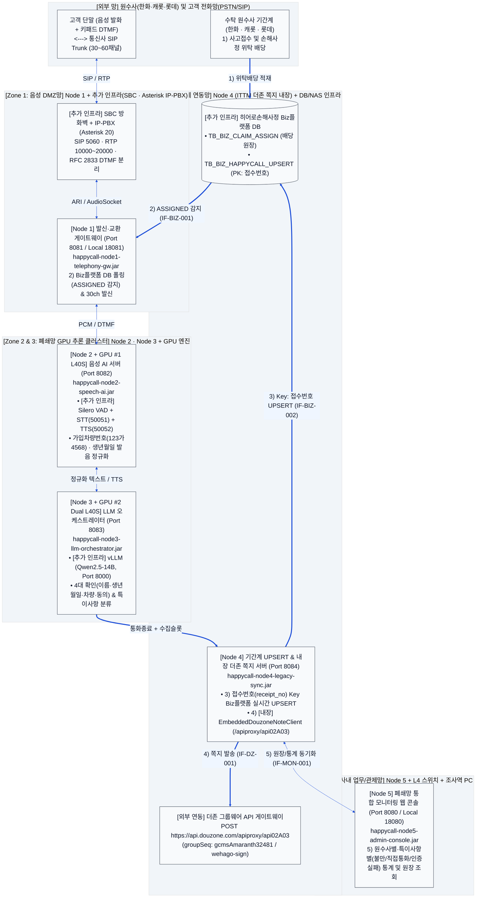
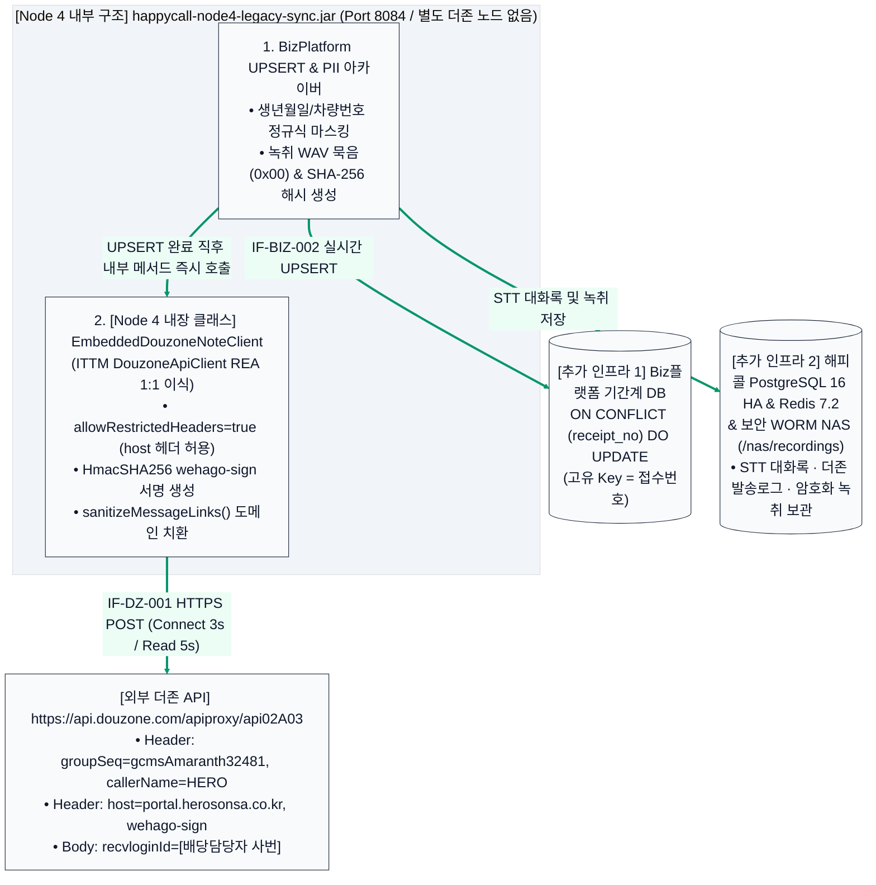

# 히어로손해사정 AI 자동 해피콜 서비스 — 인프라 상세 설계도면
**(5대 서비스 Node + Node 4 내장형 ITTM 더존 그룹웨어 API + 별도 필수 추가 인프라 아키텍처)**

---

## 1. 인프라 설계 개요 및 더존 그룹웨어 쪽지 API 통합 원칙

히어로손해사정의 AI 자동 해피콜 플랫폼을 폐쇄망(On-Premise Air-Gapped) 운영 환경에서 가동하기 위해서는 애플리케이션을 구동하는 **5대 독립 서비스 노드(`Node 1` ~ `Node 5`)** 외에도 통신사 음성 회선, 교환기(IP-PBX), GPU 네이티브 추론 엔진, 기간계(Biz플랫폼) DB, 보안 녹취 스토리지 등 **별도의 물리/소프트웨어 기반 인프라**가 함께 구성되어야 합니다.

특히 **4) 배당 담당자 더존(Douzone) 그룹웨어 쪽지 발송 API**는 사내 **`ITTM(ITSM)` 프로젝트**([`ITSM-prod.jar`](file:///c:/myWork/workspace/scratch/ITTM/dist/ITSM-prod.jar) / [`DouzoneApiClient.java`](file:///c:/myWork/workspace/scratch/ITTM/src/main/java/com/hero/itsm/util/DouzoneApiClient.java))를 **REA(`inspect_artifact` Evidence ID: `ev_60d4eed27601980a8c180b713c459fc270b45a04722e63f371b60634a1ade6f9`)**로 역공학 분석한 결과, **별도의 중계 노드를 추가하지 않고** 통화 종료 직후 기간계(Biz플랫폼) 실시간 UPSERT(`Key: 접수번호`)를 수행하는 **`Node 4`([`LegacySyncArchiverServer.java`](file:///c:/myWork/workspace/scratch/AI_Call/src/com/hero/happycall/node4/LegacySyncArchiverServer.java)) 내부에 `EmbeddedDouzoneNoteClient`로 직접 내장**하여 `https://api.douzone.com/apiproxy/api02A03`(`host: portal.herosonsa.co.kr`, `HmacSHA256 wehago-sign`)을 즉시 호출하도록 설계했습니다.

---

## 2. [도표 1] 5대 서비스 노드 vs 별도 필수 추가 인프라 매핑표

| 보안 망 영역 | 5대 서비스 노드 (Java 독립 실행 데몬) | 별도 추가로 필요한 실제 인프라 항목 (H/W · S/W · 대외망) |
| :--- | :--- | :--- |
| **Zone 1** **음성 DMZ망** | **Node 1: 발신·교환 게이트웨이** • `happycall-node1-telephony-gw.jar` • Local `18081` / Prod `8081` | • **통신사 SIP Trunk 전용선**: KT / LG U+ / SKB (30~60채널, G.711 A-law) • **음성 방화벽 (SBC)**: SIP/RTP 패킷 보안 및 미디어 릴레이 • **IP-PBX 엔진 (Asterisk 20 / FreeSWITCH)**: SIP(5060), RTP(10000~20000), RFC 2833 DTMF 분리 |
| **Zone 2** **AI 음성망 (GPU #1)** | **Node 2: 음성 AI 처리 서버** • `happycall-node2-speech-ai.jar` • Local `18082` / Prod `8082` | • **GPU #1 물리 서버**: NVIDIA L40S 48GB × 1~2기 + CUDA 12.4 • **실시간 VAD 엔진 (Silero VAD)**: 150ms 이내 고객 끼어들기(Barge-in) 감지 • **한국어 STT 엔진**: Faster-Whisper Turbo / VITO On-Premise (`gRPC 50051`) • **초저지연 TTS 엔진**: CosyVoice 2.0 / MeloTTS TensorRT (`gRPC 50052`) |
| **Zone 3** **AI 코어망 (GPU #2)** | **Node 3: LLM 대화 오케스트레이터** • `happycall-node3-llm-orchestrator.jar` • Local `18083` / Prod `8083` | • **GPU #2 물리 서버**: NVIDIA L40S 48GB × 2기 (NVLink) + Container Toolkit • **vLLM 추론 서버 컨테이너**: `vllm/vllm-openai:v0.6.3` (`HTTP 8000`) • **로컬 LLM 모델 스토리지 (`/models/llm`)**: `Qwen2.5-14B-Instruct-AWQ` |
| **Zone 4** **기간계 연동망** *(더존 쪽지 내장)* | **Node 4: 기간계 UPSERT & 더존 쪽지 통합** • `happycall-node4-legacy-sync.jar` • Local `18084` / Prod `8084` • **[내장] ITTM `DouzoneApiClient`** | • **원수사 대외계 전용선**: 한화손해보험 · 캐롯손해보험 · 롯데손해보험 전용회선 • **히어로손해사정 Biz플랫폼 DB**: 배당 원장(`TB_BIZ_CLAIM_ASSIGN`) 및 해피콜 UPSERT 원장(`TB_BIZ_HAPPYCALL_UPSERT`) • **외부 더존 그룹웨어 API 게이트웨이**: `https://api.douzone.com/apiproxy/api02A03` (`host: portal.herosonsa.co.kr`) 아웃바운드 HTTPS(443) 허용 • **해피콜 운영 DB & 캐시**: PostgreSQL 16 HA (`5432`) + Redis 7.2 Cluster (`6379`) • **보안 녹취 스토리지**: SAN/NAS WORM 볼륨 (`/nas/recordings`, AES-256-GCM) |
| **Zone 5** **사내 업무/관제망** | **Node 5: 폐쇄망 모니터링 웹 콘솔** • `happycall-node5-admin-console.jar` • Local `18080` / Prod `8080` | • **내부 L4 스위치 / Nginx Reverse Proxy**: HTTPS `443` ➔ `8080` SSL 종료 • **망간 내부 방화벽 (Internal FW)**: 망분리 포트 화이트리스트 통제 • **배당 담당 조사역 및 관리자 업무 PC**: 더존 메신저 및 웹 콘솔 브라우저 |

---

## 3. 물리/논리 인프라 상세 설계도면 (대형 폰트 가독성 최적화)

### 3.1 [설계도 1-1] 전체 5-Zone 인프라 및 망간 데이터 흐름 총괄도

---

### 3.2 [설계도 1-2] Zone 4 (`Node 4` 내장 더존 API · 기간계 DB · 보안 스토리지) 상세 확대도

---

## 4. [도표 2] ITTM(ITSM) REA 역공학 기반 더존 쪽지 API 인프라 설정 규격

| 설정 항목 | 적용 값 (`Node 4` 내장 `EmbeddedDouzoneNoteClient`) | 설명 및 인프라 요구사항 |
| :--- | :--- | :--- |
| **REA 분석 출처** | `ITTM/dist/ITSM-prod.jar` (`DouzoneApiClient.class`) | REA Evidence ID: `ev_60d4eed27601980a8c180b713c459fc270b45a04722e63f371b60634a1ade6f9` |
| **JVM 시스템 프로퍼티** | `-Dsun.net.http.allowRestrictedHeaders=true` | `LegacySyncArchiverServer` `static {}` 블록에 내장되어 `host` 헤더 수동 지정 허용 |
| **더존 API URL** | `POST https://api.douzone.com/apiproxy/api02A03` | Zone 4 방화벽에서 아웃바운드 `TCP 443` 허용 (Connect `3,000ms` / Read `5,000ms`) |
| **그룹웨어 식별 코드** | `groupSeq = "gcmsAmaranth32481"` | `callerName = "HERO"`, `loginId = "admin"`, `empSeq = "admin"`, `host = "portal.herosonsa.co.kr"` |
| **`wehago-sign` 서명** | `HmacSHA256` + `Base64` 인코딩 | 서명 원문: `MSG_ACCESS_TOKEN + transactionId(30자) + timeStamp(ms) + "/apiproxy/api02A03"` |

---

## 5. [도표 3] 망분리 구간별 방화벽(ACL) 포트 설계 매트릭스

| 출발지 (Source) | 목적지 (Destination) | 포트 / 프로토콜 | 통신 목적 및 인터페이스 ID |
| :--- | :--- | :---: | :--- |
| **통신사 SIP 전용망** | **Zone 1: SBC / IP-PBX** | `UDP/TCP 5060` `UDP 10000~20000` | SIP 호 시그널링 및 RTP 음성 / RFC 2833 DTMF 패킷 송수신 |
| **Zone 1: Node 1 (`8081`)** | **Zone 4: Biz플랫폼 DB** | `TCP 1521 / 5432` | `IF-BIZ-001` 원수사 배당 완료(`ASSIGNED`) 대상 실시간 폴링 조회 |
| **Zone 1: Node 1 (`8081`)** | **Zone 2: Node 2 (`8082`)** | `TCP 8082` (`18082`) | 실시간 PCM 오디오 프레임 및 DTMF 이벤트 전달 |
| **Zone 2: Node 2 (`8082`)** | **Zone 2: STT/TTS 엔진** | `TCP 50051, 50052` | Faster-Whisper/VITO STT 및 CosyVoice/MeloTTS gRPC 통신 |
| **Zone 2: Node 2 (`8082`)** | **Zone 3: Node 3 (`8083`)** | `TCP 8083` (`18083`) | 정규화된 고객 응답(이름·생년월일·차량번호·동의) 전달 |
| **Zone 3: Node 3 (`8083`)** | **Zone 3: vLLM 컨테이너** | `TCP 8000` (HTTP) | 로컬 LLM Guided JSON 추론 및 통화 종료 3줄 요약 생성 |
| **Zone 3: Node 3 (`8083`)** | **Zone 4: Node 4 (`8084`)** | `TCP 8084` (`18084`) | 통화 종료 이벤트, 4대 확인 결과, 특이사항 분류 코드 전달 |
| **Zone 4: Node 4 (`8084`)** | **Zone 4: Biz플랫폼 DB** | `TCP 1521 / 5432` | `IF-BIZ-002` **`접수번호`(`receipt_no`) Key 기준 기간계 실시간 UPSERT** |
| **Zone 4: Node 4 (`8084`)** | **더존 API (`api.douzone.com`)** | `TCP 443` (HTTPS) | `IF-DZ-001` **Node 4 내장 `EmbeddedDouzoneNoteClient` ➔ `/apiproxy/api02A03` 호출** |
| **Zone 5: Node 5 (`8080`)** | **Zone 1~4 (`8081~8084`)** | `TCP 8081~8084` | `IF-MON-001` 클러스터 헬스체크, 원장 조회, 재-UPSERT 및 더존 쪽지 재발송 |
