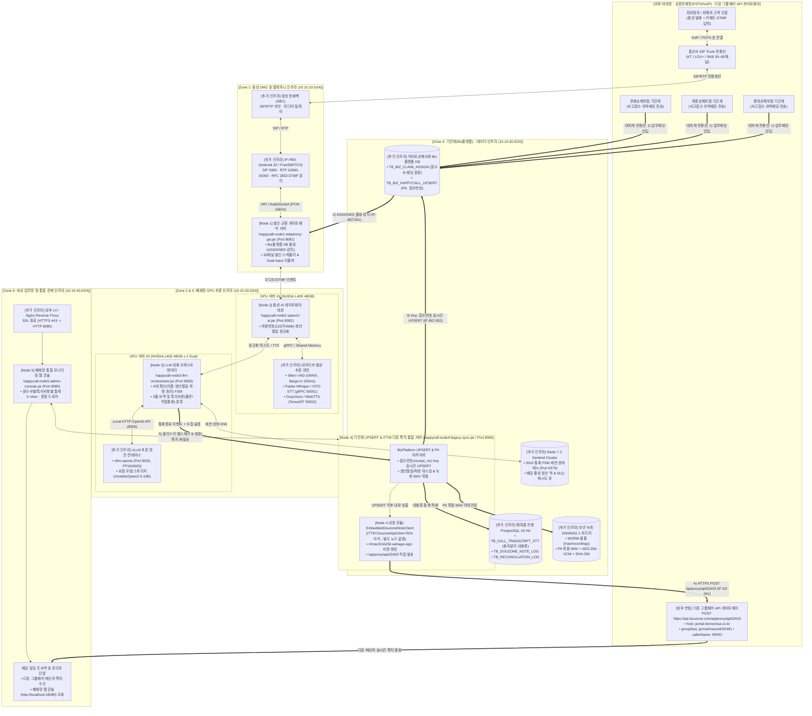

# 히어로손해사정 AI 자동 해피콜 서비스 — 인프라 상세 설계도면
**(5대 서비스 Node + Node 4 내장형 ITTM 더존 그룹웨어 API + 별도 필수 추가 인프라 아키텍처)**

---

## 1. 인프라 설계 개요 및 더존 그룹웨어 쪽지 API 통합 원칙

히어로손해사정의 AI 자동 해피콜 플랫폼을 폐쇄망(On-Premise Air-Gapped) 운영 환경에서 가동하기 위해서는 애플리케이션을 구동하는 **5대 독립 서비스 노드(`Node 1` ~ `Node 5`)** 외에도 통신사 음성 회선, 교환기(IP-PBX), GPU 네이티브 추론 엔진, 기간계(Biz플랫폼) DB, 보안 녹취 스토리지 등 **별도의 물리/소프트웨어 기반 인프라**가 함께 구성되어야 합니다.

특히 **4) 배당 담당자 더존(Douzone) 그룹웨어 쪽지 발송 API**는 사내 **`ITTM(ITSM)` 프로젝트**([`ITSM-prod.jar`](file:///c:/myWork/workspace/scratch/ITTM/dist/ITSM-prod.jar) / [`DouzoneApiClient.java`](file:///c:/myWork/workspace/scratch/ITTM/src/main/java/com/hero/itsm/util/DouzoneApiClient.java))를 **REA(`inspect_artifact` Evidence ID: `ev_60d4eed27601980a8c180b713c459fc270b45a04722e63f371b60634a1ade6f9`)**로 역공학 분석한 결과, **별도의 중계 노드를 추가하지 않고** 통화 종료 직후 기간계(Biz플랫폼) 실시간 UPSERT(`Key: 접수번호`)를 수행하는 **`Node 4`([`LegacySyncArchiverServer.java`](file:///c:/myWork/workspace/scratch/AI_Call/src/com/hero/happycall/node4/LegacySyncArchiverServer.java)) 내부에 `EmbeddedDouzoneNoteClient`로 직접 내장**하여 `https://api.douzone.com/apiproxy/api02A03`(`host: portal.herosonsa.co.kr`, `HmacSHA256 wehago-sign`)을 즉시 호출하도록 설계했습니다.

---

## 2. 5대 서비스 노드 vs 별도 필수 추가 인프라 매핑 일람

| 구분 | 인프라 영역 (보안 망) | 5대 서비스 노드 (Java JAR 데몬) | 별도 추가로 필요한 실제 인프라 항목 (H/W · S/W · 대외망) |
| :--- | :--- | :--- | :--- |
| **영역 1** | **대외계 / 음성 DMZ망** | **Node 1: 발신·교환 게이트웨이** (`happycall-node1-telephony-gw.jar` / Port `8081`) | • **통신사 SIP Trunk 전용선** (KT / LG U+ / SKB, 30~60채널 G.711 A-law) • **음성 방화벽 (SBC: Session Border Controller)**: SIP/RTP 패킷 보안 및 DoS 방어 • **IP-PBX 엔진 (Asterisk 20 LTS / FreeSWITCH)**: SIP 시그널링(5060), RTP 미디어(10000~20000), RFC 2833 DTMF 패킷 분리 |
| **영역 2** | **AI 음성 추론망 (GPU #1)** | **Node 2: 음성 AI 처리 서버** (`happycall-node2-speech-ai.jar` / Port `8082`) | • **GPU #1 물리 서버 (NVIDIA L40S 48GB × 1~2기)** + CUDA 12.4 / cuDNN 9 • **실시간 VAD 엔진 (Silero VAD ONNX Runtime)**: 150ms 이내 고객 끼어들기(Barge-in) 감지 • **한국어 STT 엔진 (ReturnZero VITO On-Premise 또는 Faster-Whisper-large-v3 Turbo gRPC, Port `50051`)** • **초저지연 TTS 엔진 (CosyVoice 2.0 / MeloTTS-Korean TensorRT, Port `50052`)** |
| **영역 3** | **AI 코어 추론망 (GPU #2)** | **Node 3: LLM 대화 오케스트레이터** (`happycall-node3-llm-orchestrator.jar` / Port `8083`) | • **GPU #2 물리 서버 (NVIDIA L40S 48GB × 2기, NVLink)** + NVIDIA Container Toolkit • **vLLM 추론 서버 컨테이너 (`vllm/vllm-openai:v0.6.3`, Port `8000`)** • **로컬 LLM 가중치 스토리지 (`/models/llm`)**: `Qwen2.5-14B-Instruct-AWQ` 또는 `EXAONE-3.5-7.8B-Instruct` |
| **영역 4** | **기간계 연동 / 데이터망** *(더존 쪽지 API 내장)* | **Node 4: 기간계 UPSERT & ITTM 더존 쪽지 통합 서버** (`happycall-node4-legacy-sync.jar` / Port `8084`) • **별도 노드 없이 `Node 4` 내부에 ITTM `DouzoneApiClient` 내장** | • **원수사 대외계 전용선 (한화손해보험 · 캐롯손해보험 · 롯데손해보험 VPN/전용회선)** • **히어로손해사정 기간계 DBMS (Biz플랫폼 DB)**: 배당 원장(`TB_BIZ_CLAIM_ASSIGN`) 및 해피콜 UPSERT 원장(`TB_BIZ_HAPPYCALL_UPSERT`) • **더존(Douzone) 그룹웨어 API 게이트웨이 (`https://api.douzone.com/apiproxy/api02A03`, `host: portal.herosonsa.co.kr`, `groupSeq: gcmsAmaranth32481`)**: 아웃바운드 HTTPS(443) 화이트리스트 방화벽 허용 • **해피콜 운영 DBMS (PostgreSQL 16 HA Master-Standby, Port `5432`)** • **인메모리 세션·큐 브로커 (Redis 7.2 Sentinel Cluster, Port `6379`)** • **보안 녹취 스토리지 (SAN/NAS WORM 볼륨 + KMS AES-256-GCM 암호화, `/nas/recordings`)** |
| **영역 5** | **사내 업무 / 관제망** | **Node 5: 폐쇄망 모니터링 웹 콘솔** (`happycall-node5-admin-console.jar` / Port `8080`) | • **내부 L4 스위치 / 리버스 프록시 (Nginx / HAProxy, HTTPS `443` ➔ `8080`)** • **망간 내부 방화벽 (Internal Firewall)**: 업무망·추론망·기간계망 포트 화이트리스트 통제 • **사내 SSO / 계정 인증 연동 모듈 및 조사역·관리자 업무 PC 브라우저** |

---

## 3. 전체 물리/논리 인프라 상세 설계도면 (Mermaid Architecture Blueprint)

---

## 4. ITTM(ITSM) 프로젝트 REA 역공학 기반 더존 쪽지 API 인프라 연동 명세

### 4.1 REA 분석 대상 및 아키텍처 통합 결정
- **REA 분석 아티팩트**: [`C:\myWork\workspace\scratch\ITTM\dist\ITSM-prod.jar`](file:///c:/myWork/workspace/scratch/ITTM/dist/ITSM-prod.jar) (`SHA-256: 1b077a0716fe079403251716863e669b6c7f042b2f849b102be5d721f2018fdb`, `REA Evidence ID: ev_60d4eed27601980a8c180b713c459fc270b45a04722e63f371b60634a1ade6f9`) 및 [`DouzoneApiClient.java`](file:///c:/myWork/workspace/scratch/ITTM/src/main/java/com/hero/itsm/util/DouzoneApiClient.java).
- **가장 가까운 노드에 무노드(Zero-Extra-Node) 통합**:
  - 더존 쪽지 발송은 **"3) 통화 종료 후 기간계(Biz플랫폼)에 `접수번호`를 Key로 UPSERT"**한 직후 **"4) 배당 담당자에게 알림 발송"**하는 후속 트랜잭션이므로, 별도 서버나 데몬을 띄우지 않고 **`Node 4` (`happycall-node4-legacy-sync.jar`, Port `18084` / 운영 `8084`) 내부 클래스(`EmbeddedDouzoneNoteClient`)로 직접 통합**했습니다.

### 4.2 Node 4 ➔ 더존 그룹웨어 쪽지 API 네트워크 및 인증 규격 (`IF-DZ-001`)
1. **JVM 네트워크 제약 해제 프로퍼티**:
   - `System.setProperty("sun.net.http.allowRestrictedHeaders", "true");` (Java `HttpURLConnection`에서 `host: portal.herosonsa.co.kr` 헤더를 직접 지정하기 위해 Node 4 기동 시 정적 초기화 블록에서 자동 설정)
2. **외부 방화벽(Egress ACL) 허용 대상**:
   - **목적지 URL**: `https://api.douzone.com/apiproxy/api02A03` (`TCP 443 HTTPS`)
   - **가상 호스트 헤더 (`host`)**: `portal.herosonsa.co.kr`
   - **타임아웃 설정**: Connect Timeout `3,000ms` (3초), Read Timeout `5,000ms` (5초)
3. **더존 API 인증 상수 및 `wehago-sign` 서명 알고리즘**:
   - `MSG_ACCESS_TOKEN`: `"NRliit56aV9bA3DFQNCzP4IgV6BVIl"`
   - `MSG_HASH_KEY`: `"16254241317765052739781095052517159986033643"`
   - `GROUP_SEQ`: `"gcmsAmaranth32481"` / `MSG_CALLER_NAME`: `"HERO"` / `MSG_LOGIN_ID`: `"admin"`
   - `transaction-id`: `UUID.randomUUID().toString().replace("-", "").substring(0, 30)` (30자리)
   - `timestamp`: `String.valueOf(System.currentTimeMillis())` (Epoch Milliseconds)
   - `wehago-sign`: `Base64(HmacSHA256(MSG_ACCESS_TOKEN + transactionId + timeStamp + "/apiproxy/api02A03", MSG_HASH_KEY))`

---

## 5. 망분리 구간별 방화벽(ACL) 포트 설계 매트릭스

| 출발지 (Source Zone) | 목적지 (Destination Zone) | 프로토콜 / 포트 | 통신 목적 및 인터페이스 ID |
| :--- | :--- | :---: | :--- |
| **통신사 SIP 전용망** | **Zone 1: SBC / IP-PBX** | `UDP/TCP 5060`, `UDP 10000~20000` | SIP 호 시그널링 및 RTP 음성/RFC 2833 DTMF 패킷 송수신 |
| **Zone 1: Node 1 (`8081`)** | **Zone 4: Biz플랫폼 DB** | `TCP 1521 / 5432` | `IF-BIZ-001` 원수사 배당 완료(`ASSIGNED`) 대상 실시간 폴링 조회 |
| **Zone 1: Node 1 (`8081`)** | **Zone 2: Node 2 (`8082`)** | `TCP 8082` (Local `18082`) | 실시간 PCM 오디오 프레임 및 DTMF 이벤트 전달 |
| **Zone 2: Node 2 (`8082`)** | **Zone 2: STT/TTS GPU 엔진** | `TCP 50051, 50052` (gRPC) | Faster-Whisper/VITO STT 인식 및 CosyVoice/MeloTTS 음성 합성 |
| **Zone 2: Node 2 (`8082`)** | **Zone 3: Node 3 (`8083`)** | `TCP 8083` (Local `18083`) | 정규화된 고객 응답(이름·생년월일·차량번호·동의) 전달 및 다음 발화 수신 |
| **Zone 3: Node 3 (`8083`)** | **Zone 3: vLLM 컨테이너** | `TCP 8000` (HTTP) | 로컬 LLM Structured JSON 추론 및 통화 종료 3줄 요약 생성 |
| **Zone 3: Node 3 (`8083`)** | **Zone 4: Redis Cluster** | `TCP 6379` | 30채널 동시 통화 FSM 세션 상태 조회/갱신 |
| **Zone 3: Node 3 (`8083`)** | **Zone 4: Node 4 (`8084`)** | `TCP 8084` (Local `18084`) | 통화 종료 이벤트, 4대 확인 결과, 특이사항 분류 코드 전달 |
| **Zone 4: Node 4 (`8084`)** | **Zone 4: Biz플랫폼 DB** | `TCP 1521 / 5432` | `IF-BIZ-002` **`접수번호`(`receipt_no`) Key 기준 기간계 실시간 UPSERT** |
| **Zone 4: Node 4 (`8084`)** | **외부 더존 API (`api.douzone.com`)** | `TCP 443` (HTTPS Outbound) | `IF-DZ-001` **Node 4 내장 `EmbeddedDouzoneNoteClient` ➔ `/apiproxy/api02A03` (`host: portal.herosonsa.co.kr`, `wehago-sign`)** |
| **Zone 4: Node 4 (`8084`)** | **Zone 4: 해피콜 PostgreSQL / NAS** | `TCP 5432`, `NFS/SMB 2049` | 화자 분리 STT 전문 적재 및 PII 묵음 녹취 파일 아카이빙 |
| **Zone 5: Node 5 (`8080`)** | **Zone 1~4: Node 1~4 (`8081~8084`)** | `TCP 8081~8084` (Local `18081~18084`) | `IF-MON-001` 클러스터 헬스체크, 원장 조회, 재-UPSERT 및 더존 쪽지 재발송 |
| **사내 업무망 (조사역 PC)** | **Zone 5: L4 / Node 5 (`8080`)** | `TCP 443 -> 8080` (Local `18080`) | 폐쇄망 통합 모니터링 및 특이사항 통계 웹 콘솔 접속 |
