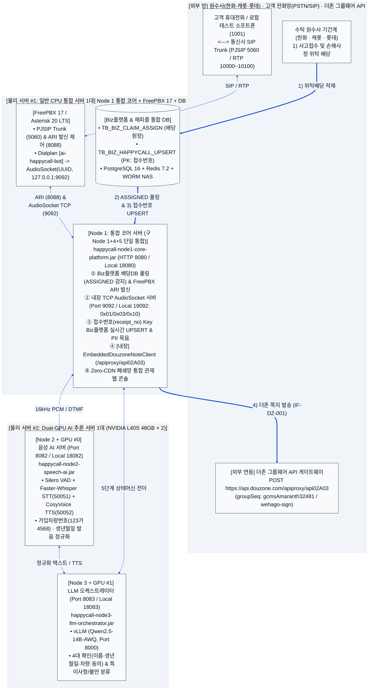

# 히어로손해사정 AI 자동 해피콜 서비스 — 인프라 상세 설계도면
**(물리 서버 2대 도입 · 3-Node 통합 아키텍처 + FreePBX 17 + Node 1 내장형 ITTM 더존 그룹웨어 API)**

---

## 1. 물리 서버 도입 대수 확정 및 3-Node 통합 설계 개요

1. **구 `Node 1`(발신·교환 게이트웨이) + 구 `Node 4`(기간계 `접수번호` UPSERT & ITTM 더존 쪽지 API) + 구 `Node 5`(폐쇄망 관제 웹 콘솔)의 단일 통합**:
   - 위 3개 영역은 모두 GPU가 필요 없는 일반 CPU 및 네트워크/DB I/O 워크로드이므로, **단 하나의 통합 애플리케이션인 `Node 1: 통합 코어 서버` ([`CorePlatformServer.java`](file:///c:/myWork/workspace/scratch/AI_Call/src/com/hero/happycall/node1/CorePlatformServer.java) / `happycall-node1-core-platform.jar`)**로 완전히 합쳐서 구현했습니다.
2. **실제 도입해야 할 물리 서버 대수: 총 2대 (또는 GPU 분리 시 3대)**:
   - **물리 서버 #1 (일반 CPU 통합 코어 · FreePBX · DB 서버 1대)**: `Node 1 (happycall-node1-core-platform.jar, HTTP 8080 / 내장 AudioSocket TCP 9092)` + `FreePBX 17 (Asterisk 20 LTS)` + `PostgreSQL 16` + `Redis 7.2` 동시 구동.
   - **물리 서버 #2 (Dual-GPU AI 추론 서버 1대 — NVIDIA L40S 48GB × 2)**:
     - `GPU #0`: **`Node 2 음성 AI 서버` (`happycall-node2-speech-ai.jar`, Port `8082`)** + Silero VAD / Faster-Whisper STT / CosyVoice 2.0 TTS
     - `GPU #1`: **`Node 3 LLM 오케스트레이터 서버` (`happycall-node3-llm-orchestrator.jar`, Port `8083`)** + vLLM (`Qwen2.5-14B/32B-AWQ`)

---

## 2. [도표 1] 물리 서버 2대 및 3대 소프트웨어 노드 매핑표

| 물리 서버 구분 (실제 도입 대수) | 3대 서비스 노드 (Java 독립 실행 데몬) | 별도 추가로 필요한 실제 인프라 항목 (H/W · S/W · 대외망) |
| :--- | :--- | :--- |
| **물리 서버 #1** **통합 코어 · FreePBX · DB 서버** *(일반 CPU 서버 1대 / GPU 불필요)* | **Node 1: 통합 코어 서버 (구 Node 1+4+5 단일 통합)** • `happycall-node1-core-platform.jar` • HTTP: Local `18080` / Prod `8080` • **내장 AudioSocket TCP: Local `19092` / Prod `9092`** • **[내장] FreePBX ARI 발신기 & AudioSocket 서버** • **[내장] Biz플랫폼 `접수번호` UPSERT** • **[내장] ITTM `DouzoneApiClient` (`/apiproxy/api02A03`)** • **[내장] Zero-CDN 통합 관제 웹 콘솔** | • **물리 서버 #1 H/W**: 16~32 Core CPU, 64GB RAM, NVMe 2TB RAID-1 • **FreePBX 17 (Asterisk 20 LTS)**: PJSIP(`5060/udp`), RTP(`10000~10100/udp`), ARI(`8088/tcp`), AMI(`5038/tcp`), `app_audiosocket` ([`freepbx-setup/`](file:///c:/myWork/workspace/scratch/AI_Call/freepbx-setup) 패키지 제공) • **통신사 SIP Trunk 전용선**: KT / LG U+ / SKB (30채널, G.711/slin16, RFC4733 DTMF) • **히어로손해사정 Biz플랫폼 DB 연동**: `TB_BIZ_CLAIM_ASSIGN` 폴링 및 `TB_BIZ_HAPPYCALL_UPSERT` (`PK: 접수번호`) • **외부 더존 그룹웨어 API**: `https://api.douzone.com/apiproxy/api02A03` (`host: portal.herosonsa.co.kr`, `wehago-sign`) • **해피콜 DB/캐시/녹취 스토리지**: PostgreSQL 16 (`5432`) + Redis 7.2 (`6379`) + WORM NAS (`/nas/recordings`) |
| **물리 서버 #2 (GPU #0)** **AI 음성 추론 영역** *(Dual-GPU 서버 #2의 1번 GPU)* | **Node 2: 음성 AI 처리 서버** • `happycall-node2-speech-ai.jar` • HTTP: Local `18082` / Prod `8082` | • **GPU #0 하드웨어**: NVIDIA L40S 48GB (`CUDA_VISIBLE_DEVICES=0`) • **실시간 VAD 엔진 (Silero VAD)**: 150ms 이내 고객 끼어들기(Barge-in) 감지 • **한국어 STT 엔진**: Faster-Whisper Turbo (`gRPC 50051`) • **초저지연 TTS 엔진**: CosyVoice 2.0 TensorRT (`gRPC 50052`) |
| **물리 서버 #2 (GPU #1)** **AI LLM 상태머신 영역** *(Dual-GPU 서버 #2의 2번 GPU)* | **Node 3: LLM 대화 오케스트레이터** • `happycall-node3-llm-orchestrator.jar` • HTTP: Local `18083` / Prod `8083` | • **GPU #1 하드웨어**: NVIDIA L40S 48GB (`CUDA_VISIBLE_DEVICES=1`) • **vLLM 추론 서버 컨테이너**: `vllm/vllm-openai:v0.6.3` (`HTTP 8000`) • **로컬 LLM 모델 스토리지 (`/models/llm`)**: `Qwen2.5-14B-Instruct-AWQ` |

---

## 3. 물리/논리 인프라 상세 설계도면 (대형 폰트 가독성 최적화)

### 3.1 [설계도 1-1] 물리 서버 2대 · 3-Node 통합 아키텍처 및 FreePBX 연동 총괄도

---

## 4. [도표 2] 물리 서버 간 및 대외 구간 방화벽(ACL) 포트 매트릭스

| 출발지 (Source) | 목적지 (Destination) | 포트 / 프로토콜 | 통신 목적 및 인터페이스 ID |
| :--- | :--- | :---: | :--- |
| **통신사 SIP 전용망** | **물리 서버 #1: FreePBX 17** | `UDP/TCP 5060` `UDP 10000~10100` | SIP 호 시그널링 및 RTP 음성 / RFC 4733 DTMF 패킷 송수신 |
| **물리 서버 #1: Node 1 (`8080`)** | **물리 서버 #1: FreePBX ARI** | `TCP 8088` (HTTP) | `IF-PBX-001` `POST /ari/channels` 아웃바운드 해피콜 발신 제어 |
| **물리 서버 #1: FreePBX 17** | **물리 서버 #1: Node 1 AudioSocket** | `TCP 9092` (Local `19092`) | `IF-PBX-001` `AudioSocket` 양방향 16kHz PCM(`0x10`) 및 DTMF(`0x03`) 스트리밍 |
| **물리 서버 #1: Node 1 (`8080`)** | **물리 서버 #2: Node 2 (`8082`)** | `TCP 8082` (Local `18082`) | 실시간 음성 프레임 STT/TTS 처리 및 차량번호(`123가4568`) 발음 정규화 |
| **물리 서버 #1: Node 1 (`8080`)** | **물리 서버 #2: Node 3 (`8083`)** | `TCP 8083` (Local `18083`) | 5단계 상태머신(`S1`~`S5`) 전이 및 특이사항/고객불만 분류 추론 |
| **물리 서버 #1: Node 1 (`8080`)** | **Biz플랫폼 기간계 DB** | `TCP 1521 / 5432` | `IF-BIZ-001` 배당 폴링 및 `IF-BIZ-002` **`접수번호`(`receipt_no`) Key 실시간 UPSERT** |
| **물리 서버 #1: Node 1 (`8080`)** | **더존 API (`api.douzone.com`)** | `TCP 443` (HTTPS) | `IF-DZ-001` **Node 1 내장 `EmbeddedDouzoneNoteClient` ➔ `/apiproxy/api02A03` 호출** |
| **사내 조사역 / 관리자 PC** | **물리 서버 #1: Node 1 (`8080`)** | `TCP 8080` (Local `18080`) | `IF-MON-001` Zero-CDN 통합 관제 웹 콘솔 접속, 원장 조회 및 재발송 제어 |
