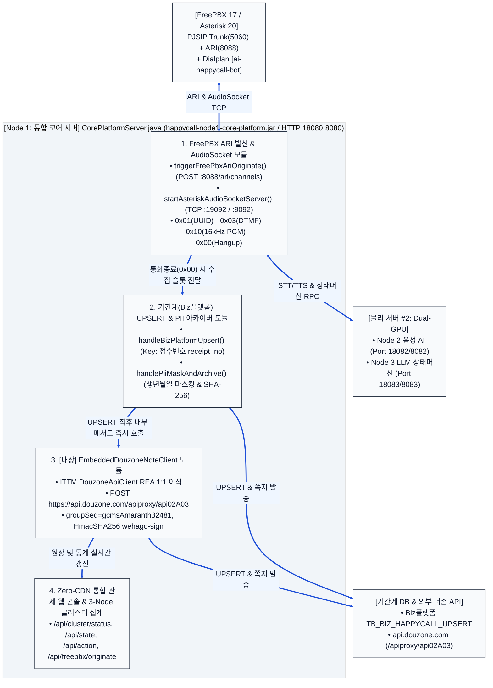
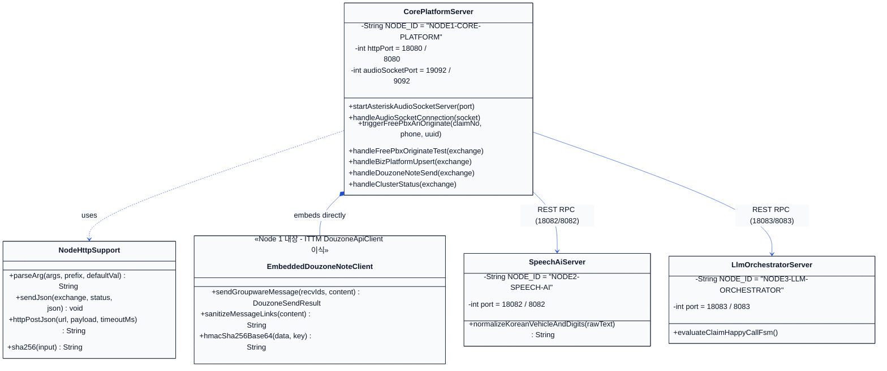

# 히어로손해사정 AI 자동 해피콜 서비스 — 응용프로그램 상세 설계도면
**(3대 독립 Node 애플리케이션 [Node 1 통합 코어 + Node 2 음성 AI + Node 3 LLM] + FreePBX AudioSocket + 내장형 ITTM 더존 API)**

---

## 1. 응용프로그램 3-Node 통합 아키텍처 설계 개요

히어로손해사정 AI 자동 해피콜 응용프로그램은 **물리 서버 2대**에서 각각 독립적인 프로세스로 기동되는 **3개 실행 JAR(`Node 1`, `Node 2`, `Node 3`)**로 구성됩니다.

1. **`Node 1: 통합 코어 서버` ([`CorePlatformServer.java`](file:///c:/myWork/workspace/scratch/AI_Call/src/com/hero/happycall/node1/CorePlatformServer.java) / `happycall-node1-core-platform.jar`)**:
   - 기존 `Node 1`(Biz플랫폼 배당DB 폴링 & PBX 게이트웨이) + 기존 `Node 4`(Biz플랫폼 `접수번호` UPSERT + ITTM `DouzoneApiClient` 더존 쪽지 내장 + PII 마스킹) + 기존 `Node 5`(Zero-CDN 관제 웹 콘솔)를 **하나의 단일 프로세스로 완전 통합**했습니다.
   - 추가로 **FreePBX 17 (Asterisk 20 LTS)** 연동을 위해 **내장 TCP `AudioSocket` 서버(`Local 19092` / `Prod 9092`: `0x01` UUID, `0x03` DTMF, `0x10` 16kHz PCM, `0x00` Hangup)**와 **Asterisk ARI 아웃바운드 발신 클라이언트(`POST /ari/channels`)**를 기본 탑재했습니다.
2. **`Node 2: 음성 AI 서버` ([`SpeechAiServer.java`](file:///c:/myWork/workspace/scratch/AI_Call/src/com/hero/happycall/node2/SpeechAiServer.java) / `happycall-node2-speech-ai.jar`)**:
   - 물리 서버 #2의 `GPU #0`에서 구동되며, Silero VAD 끼어들기 감지, Faster-Whisper STT, 한국어 가입차량번호(`123가4568`)·생년월일 발음 정규화, CosyVoice 2.0 TTS 합성을 전담합니다.
3. **`Node 3: LLM 대화 오케스트레이터` ([`LlmOrchestratorServer.java`](file:///c:/myWork/workspace/scratch/AI_Call/src/com/hero/happycall/node3/LlmOrchestratorServer.java) / `happycall-node3-llm-orchestrator.jar`)**:
   - 물리 서버 #2의 `GPU #1`에서 구동되며, 5단계 상태머신(`S1_GREETING` ~ `S5_CLOSING`)과 특이사항(본인확인실패·고객불만·직접통화희망) 분류 및 3줄 요약을 전담합니다.

---

## 2. 응용프로그램 컴포넌트 및 FreePBX · 더존 API 어댑터 설계도면

### 2.1 [설계도 2-1] Node 1 통합 코어 서버 (FreePBX AudioSocket + 기간계 UPSERT + 내장 더존 API + 웹 콘솔) 내부 구조도

---

## 3. [설계도 2-2] 3대 통합 노드 및 `EmbeddedDouzoneNoteClient` 클래스 다이어그램

---

## 4. [도표 1] 3대 통합 노드별 상세 API 및 포트 명세

| 노드 | 소스 파일 및 전용 포트 | 제공 엔드포인트 (HTTP & TCP) | 핵심 역할 및 통합 내역 |
| :--- | :--- | :--- | :--- |
| **Node 1** *(통합 코어 서버)* | [`CorePlatformServer.java`](file:///c:/myWork/workspace/scratch/AI_Call/src/com/hero/happycall/node1/CorePlatformServer.java) • HTTP: `18080` (Prod `8080`) • **AudioSocket TCP: `19092` (Prod `9092`)** | • `GET /` (Zero-CDN 관제 웹 UI) • `GET /api/health`, `/api/cluster/status` • `GET /api/freepbx/status` • `POST /api/freepbx/originate` • `POST /api/dialer/trigger` • `POST /api/bizplatform/upsert` • `POST /api/douzone/note/send` • `TCP :19092/:9092` (Asterisk AudioSocket) | • **구 Node 1 + Node 4 + Node 5 단일 통합** • **FreePBX 17 연동**: ARI 발신(`POST /ari/channels`) 및 AudioSocket(`0x01`/`0x03`/`0x10`/`0x00`) 실시간 처리 • **Biz플랫폼 UPSERT**: `Key: 접수번호(receipt_no)` 실시간 반영 • **내장 더존 쪽지**: `EmbeddedDouzoneNoteClient` (`/apiproxy/api02A03`, `wehago-sign`) |
| **Node 2** *(GPU #0 음성 AI)* | [`SpeechAiServer.java`](file:///c:/myWork/workspace/scratch/AI_Call/src/com/hero/happycall/node2/SpeechAiServer.java) • HTTP: `18082` (Prod `8082`) | • `GET /api/health` • `POST /api/speech/process` | • **Silero VAD**: 150ms 끼어들기 감지 시 TTS 즉시 중단 • **STT/TTS 엔진**: `"백이십삼가 사오육팔"` ➔ `"123가4568"` 정규화 |
| **Node 3** *(GPU #1 LLM)* | [`LlmOrchestratorServer.java`](file:///c:/myWork/workspace/scratch/AI_Call/src/com/hero/happycall/node3/LlmOrchestratorServer.java) • HTTP: `18083` (Prod `8083`) | • `GET /api/health` • `POST /api/orchestrator/transition` | • **vLLM (`8000`)**: 4대 확인 슬롯 검증 및 3줄 요약 생성 • **5단계 상태머신(`S1`~`S5`)** 및 특이사항(불만/직접통화/인증실패) 분류 |
