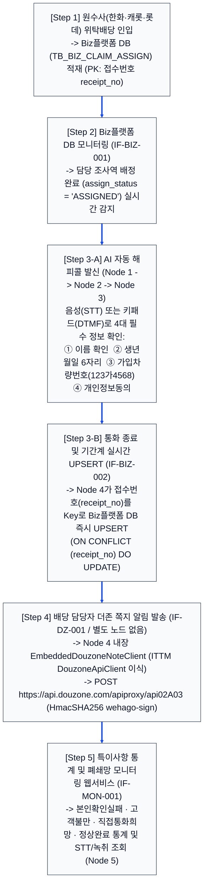
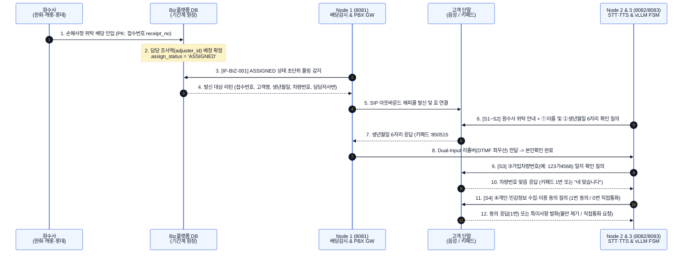
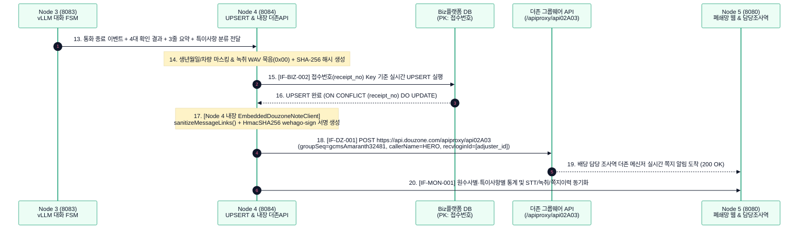
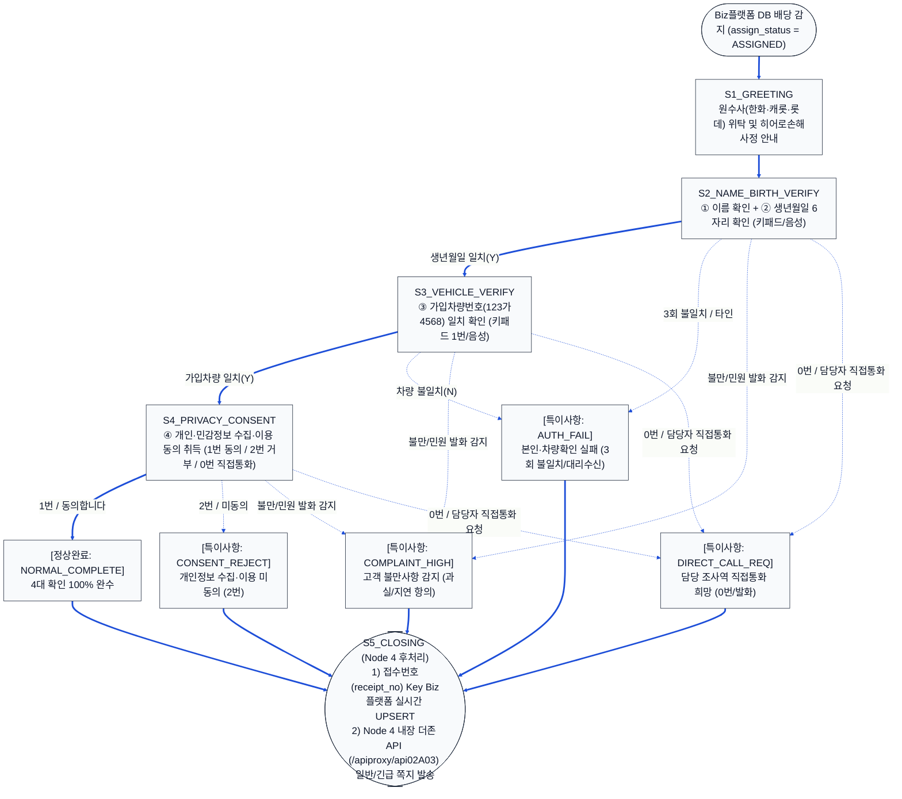
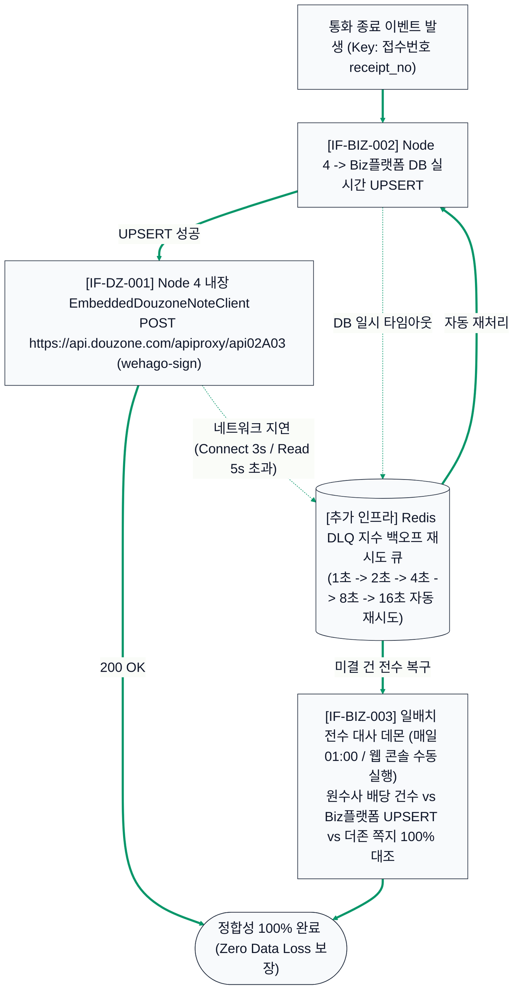

# 히어로손해사정 AI 자동 해피콜 서비스 — 업무프로세스 상세 다이어그램
**(원수사 배당 ➔ DB 감지 ➔ AI 해피콜·접수번호 UPSERT ➔ Node 4 내장 ITTM 더존 쪽지 API ➔ 특이사항 통계·모니터링)**

---

## 1. [도표 1] 히어로손해사정 5단계 핵심 업무 프로세스 정의

| 단계 | 업무 단계명 | 수행 주체 (Node 및 별도 인프라) | 핵심 입력·출력 및 비즈니스 규칙 |
| :--- | :--- | :--- | :--- |
| **Step 1** | **원수사 업무배당 인입** | • 원수사 (한화·캐롯·롯데) • [추가] 대외계 전용선 & Biz플랫폼 DB | • 수탁 보험사로부터 사고 접수 및 손해사정 위탁 데이터 수신 • Biz플랫폼 `TB_BIZ_CLAIM_ASSIGN`에 **`접수번호`(`receipt_no`)**를 PK로 적재 |
| **Step 2** | **담당자 배당 감지 (`ASSIGNED`)** | • [추가] Biz플랫폼 DB & Redis • **Node 1 (`8081` / Local `18081`)** | • 배당 테이블을 초단위 폴링/CDC 감시 • 담당 조사역(`adjuster_id`) 배정이 완료되어 `assign_status = 'ASSIGNED'`가 된 건을 즉시 발신 큐로 이관 |
| **Step 3** | **AI 해피콜 발신 및 기간계 UPSERT (`Key: 접수번호`)** | • **Node 1 (`8081`)** + IP-PBX • **Node 2 (`8082`)** + GPU STT/TTS • **Node 3 (`8083`)** + GPU vLLM • **Node 4 (`8084`)** + Biz플랫폼 DB | • 고객에게 발신하여 음성(STT) 또는 키패드(RFC 2833 DTMF)로 **① 이름, ② 생년월일(6자리), ③ 가입차량번호(`123가4568`), ④ 개인정보동의** 확인 • 통화 종료 즉시 **`접수번호`(`receipt_no`)를 Key로 Biz플랫폼 `TB_BIZ_HAPPYCALL_UPSERT`에 실시간 UPSERT** (`IF-BIZ-002`) |
| **Step 4** | **배당 담당자 더존 쪽지 발송 (Node 4 내장)** | • **Node 4 (`8084`) 내장 `EmbeddedDouzoneNoteClient`** *(별도 노드 없음)* • 외부 연동: `api.douzone.com` | • Biz플랫폼 UPSERT 완료 직후 **Node 4 내부에서 즉시 `EmbeddedDouzoneNoteClient.sendGroupwareMessage()` 호출** • `POST https://api.douzone.com/apiproxy/api02A03` (`HmacSHA256 wehago-sign`, `groupSeq=gcmsAmaranth32481`, `callerName=HERO`, `recvloginId=[adjuster_id]`) 실시간 발송 (`IF-DZ-001`) |
| **Step 5** | **특이사항 통계 및 폐쇄망 모니터링** | • **Node 4 (`8084`)** + PG DB / NAS • **Node 5 (`8080` / Local `18080`)** | • 통화 내역(화자분리 STT·3줄 요약·PII 묵음 녹취) 및 특이사항 통계(`AUTH_FAIL`, `COMPLAINT_HIGH`, `DIRECT_CALL_REQ`, `CONSENT_REJECT`, `NORMAL_COMPLETE`) 기록 • 폐쇄망 웹 콘솔(`Node 5`)에서 원수사별·특이사항별 모니터링 및 재처리 지원 |

---

## 2. [다이어그램 1] 전체 업무 프로세스 총괄 흐름도 (대형 폰트 최적화)

---

## 3. End-to-End 시스템 간 상세 시퀀스 다이어그램 (2단 분할 대형 폰트)

### 3.1 [다이어그램 2-1] 전반부 (1~3단계): 원수사 배당 감지 및 AI 해피콜 4대 항목 확인

---

### 3.2 [다이어그램 2-2] 후반부 (3-B~5단계): 접수번호 UPSERT · Node 4 내장 더존 쪽지 · 웹 관제

---

## 4. [다이어그램 3] AI 해피콜 대화 상태 머신(FSM) 및 5대 특이사항 분류도

---

## 5. [다이어그램 4] 장애 대응(DLQ 재시도) 및 일배치 정합성 대사(`IF-BIZ-003`) 흐름도

