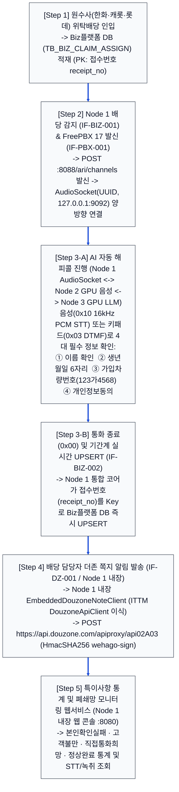
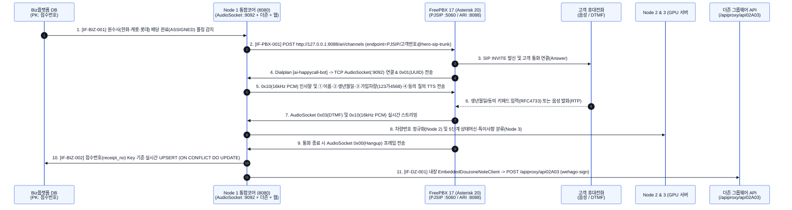

# 히어로손해사정 AI 자동 해피콜 서비스 — 업무프로세스 상세 다이어그램
**(3-Node 통합 아키텍처 · 물리 서버 2대 · FreePBX AudioSocket · Biz플랫폼 접수번호 UPSERT · Node 1 내장 더존 쪽지 API)**

---

## 1. [도표 1] 히어로손해사정 5단계 핵심 업무 프로세스 정의 (3-Node 통합 기준)

| 단계 | 업무 단계명 | 수행 주체 (3-Node 및 물리 서버 2대) | 핵심 입력·출력 및 비즈니스 규칙 |
| :--- | :--- | :--- | :--- |
| **Step 1** | **원수사 업무배당 인입** | • 원수사 (한화·캐롯·롯데) • Biz플랫폼 기간계 DB (`TB_BIZ_CLAIM_ASSIGN`) | • 수탁 보험사로부터 사고 접수 및 손해사정 위탁 데이터 수신 • Biz플랫폼 `TB_BIZ_CLAIM_ASSIGN`에 **`접수번호`(`receipt_no`)**를 PK로 적재 |
| **Step 2** | **담당자 배당 감지 (`ASSIGNED`) 및 FreePBX ARI 발신** | • **물리 서버 #1: `Node 1 통합 코어 서버`** (`8080` / Local `18080`) • **물리 서버 #1: `FreePBX 17 (Asterisk 20)`** (`ARI :8088`, `PJSIP :5060`) | • 배당 테이블을 초단위 폴링/CDC 감시하여 `assign_status = 'ASSIGNED'` 감지 시 즉시 FreePBX `POST /ari/channels` 아웃바운드 발신 명령 전송 • 고객 전화 연결(`Answer()`) 즉시 `[ai-happycall-bot]` 다이얼플랜이 **`Node 1` 내장 TCP `AudioSocket`(`9092` / Local `19092`)**으로 양방향 음성(`0x10` 16kHz PCM) 및 키패드(`0x03` DTMF) 스트림 연결 |
| **Step 3** | **AI 해피콜 4대 정보 확인 및 기간계 UPSERT (`Key: 접수번호`)** | • **물리 서버 #1: `Node 1 통합 코어`** (`AudioSocket :9092`) • **물리 서버 #2 GPU #0: `Node 2 음성 AI`** (`8082`) • **물리 서버 #2 GPU #1: `Node 3 LLM`** (`8083`) | • 고객에게 음성(STT) 또는 키패드(DTMF)로 **① 이름, ② 생년월일(6자리), ③ 가입차량번호(`123가4568`), ④ 개인정보동의** 확인 • 통화 종료(`0x00` Hangup) 즉시 **`Node 1`이 `접수번호`(`receipt_no`)를 Key로 Biz플랫폼 `TB_BIZ_HAPPYCALL_UPSERT`에 실시간 UPSERT** (`IF-BIZ-002`) |
| **Step 4** | **배당 담당자 더존 쪽지 발송 (Node 1 내장)** | • **물리 서버 #1: `Node 1` 내장 `EmbeddedDouzoneNoteClient`** • 외부 연동: `api.douzone.com` | • Biz플랫폼 UPSERT 완료 직후 **Node 1 내부에서 즉시 `EmbeddedDouzoneNoteClient.sendGroupwareMessage()` 호출** • `POST https://api.douzone.com/apiproxy/api02A03` (`HmacSHA256 wehago-sign`, `groupSeq=gcmsAmaranth32481`, `callerName=HERO`, `recvloginId=[adjuster_id]`) 실시간 발송 (`IF-DZ-001`) |
| **Step 5** | **특이사항 통계 및 폐쇄망 모니터링** | • **물리 서버 #1: `Node 1 통합 코어 웹 콘솔`** (`8080` / Local `18080`) | • 통화 내역(화자분리 STT·3줄 요약·PII 묵음 녹취) 및 특이사항 통계(`AUTH_FAIL`, `COMPLAINT_HIGH`, `DIRECT_CALL_REQ`, `CONSENT_REJECT`, `NORMAL_COMPLETE`)를 `Node 1` 내장 웹 콘솔에서 실시간 조회 및 재처리 |

---

## 2. [다이어그램 1] 전체 업무 프로세스 총괄 흐름도 (대형 폰트 최적화)

---

## 3. End-to-End 시스템 간 상세 시퀀스 다이어그램 (3-Node + FreePBX AudioSocket)

