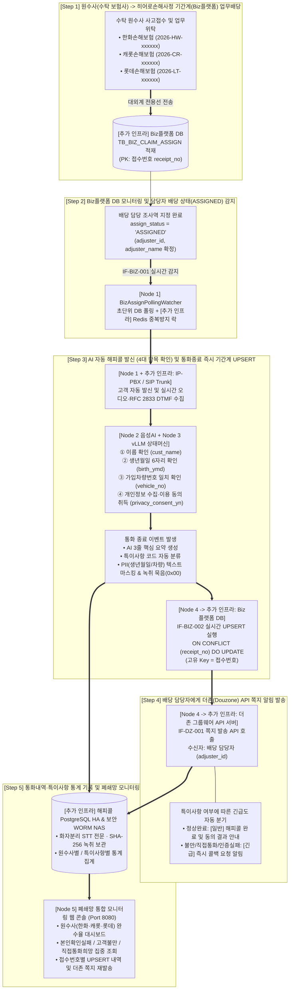
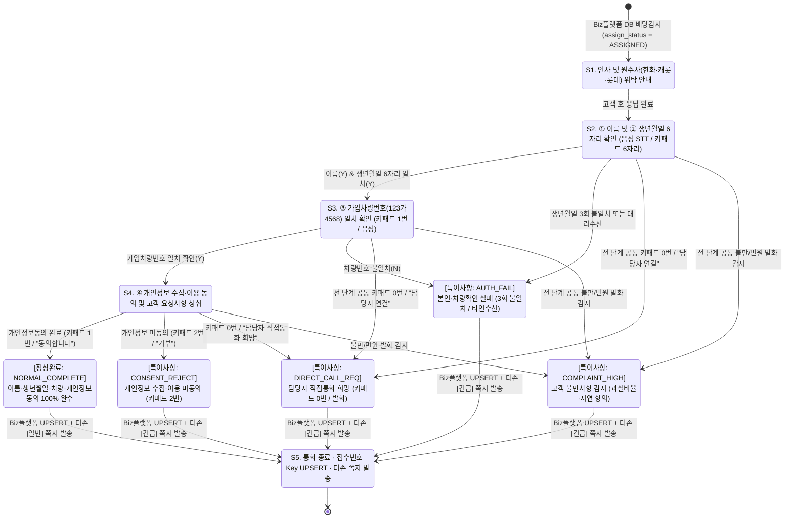
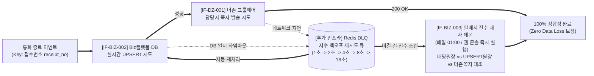

# 히어로손해사정 AI 자동 해피콜 서비스 — 업무프로세스 상세 다이어그램
**(원수사 배당 ➔ DB 감지 ➔ AI 해피콜·접수번호 UPSERT ➔ 더존 API 쪽지 ➔ 특이사항 통계·모니터링)**

---

## 1. 히어로손해사정 5단계 핵심 업무 프로세스 정의

| 프로세스 단계 | 업무 단계명 | 수행 주체 (Node 및 별도 인프라) | 핵심 입력·출력 및 비즈니스 규칙 |
| :--- | :--- | :--- | :--- |
| **Step 1** | **원수사 업무배당 인입** | • 원수사 (한화·캐롯·롯데) • [추가 인프라] 대외계 전용선 • [추가 인프라] Biz플랫폼 DB | • 수탁 보험사로부터 사고 접수 및 손해사정 위탁 데이터 수신 • Biz플랫폼 `TB_BIZ_CLAIM_ASSIGN`에 **`접수번호`(`receipt_no`)**를 PK로 적재 |
| **Step 2** | **담당자 배당 감지 (`ASSIGNED`)** | • [추가 인프라] Biz플랫폼 DB • [추가 인프라] Redis 분산 락 • **Node 1 (`8081`)** | • 배당 테이블을 초단위 폴링/CDC 감시 • 담당 조사역(`adjuster_id`) 배정이 완료되어 `assign_status = 'ASSIGNED'`가 된 건을 즉시 발신 큐로 이관 |
| **Step 3** | **AI 해피콜 발신 및 기간계 UPSERT (`Key: 접수번호`)** | • **Node 1 (`8081`)** + [추가] IP-PBX/SIP • **Node 2 (`8082`)** + [추가] GPU STT/TTS • **Node 3 (`8083`)** + [추가] GPU vLLM • **Node 4 (`8084`)** + [추가] Biz플랫폼 DB | • 고객에게 발신하여 음성(STT) 또는 키패드(RFC 2833 DTMF)로 **① 이름, ② 생년월일(6자리), ③ 가입차량번호(예: `123가4568`), ④ 개인정보동의** 확인 • 통화 종료 즉시 **`접수번호`(`receipt_no`)를 Key로 Biz플랫폼 `TB_BIZ_HAPPYCALL_UPSERT`에 실시간 UPSERT** (`IF-BIZ-002`) |
| **Step 4** | **배당 담당자 더존 API 쪽지 발송** | • **Node 4 (`8084`)** • [추가 인프라] 더존 그룹웨어 API 서버 (`IF-DZ-001`) | • Biz플랫폼 UPSERT 완료 직후 배당 담당 조사역(`adjuster_id`)에게 더존 쪽지 API 호출 • 정상 완료 시 `[일반 결과쪽지]`, 본인확인 실패·고객 불만·직접통화 희망 시 `[긴급 콜백요청 쪽지]` 즉시 발송 |
| **Step 5** | **특이사항 통계 및 폐쇄망 모니터링** | • **Node 4 (`8084`)** + [추가] PG DB / WORM NAS • **Node 5 (`8080`)** 폐쇄망 웹서비스 | • 통화 내역(화자분리 STT·3줄 요약·PII 묵음 녹취) 및 특이사항 통계(`AUTH_FAIL`, `COMPLAINT_HIGH`, `DIRECT_CALL_REQ`, `CONSENT_REJECT`, `NORMAL_COMPLETE`) 기록 • 폐쇄망 웹 콘솔(`Node 5`)에서 원수사별·특이사항별 모니터링 및 재처리 지원 |

---

## 2. 전체 업무 프로세스 총괄 흐름도 (5-Step Business Process Flowchart)

---

## 3. End-to-End 시스템 간 상세 시퀀스 다이어그램 (Sequence Diagram)

```mermaid
sequenceDiagram
    autonumber
    actor Insurer as 원수사<br/>(한화·캐롯·롯데)
    participant BizDB as [추가 인프라]<br/>Biz플랫폼 DB
    participant Node1 as [Node 1]<br/>발신·교환 GW (8081)
    participant PBX as [추가 인프라]<br/>IP-PBX & SIP Trunk
    actor Cust as 고객<br/>(음성 / 키패드)
    participant Node2 as [Node 2 + GPU #1]<br/>STT·TTS·차량정규화 (8082)
    participant Node3 as [Node 3 + GPU #2]<br/>vLLM 대화 FSM (8083)
    participant Node4 as [Node 4]<br/>UPSERT·더존연동 (8084)
    participant Douzone as [추가 인프라]<br/>더존 그룹웨어 API
    actor Adjuster as 배당 담당자<br/>(손해사정 조사역)
    participant Node5 as [Node 5]<br/>폐쇄망 모니터링 웹 (8080)

    rect rgb(241, 245, 249)
        Note over Insurer,Node1: [1단계 & 2단계] 원수사 업무배당 인입 및 담당자 배당(ASSIGNED) DB 감지
        Insurer->>BizDB: 1. 사고접수 및 손해사정 위탁 배당 (Key: 접수번호 receipt_no)
        BizDB->>BizDB: 2. 담당 조사역(adjuster_id) 배정 완료 -> assign_status = 'ASSIGNED'
        Node1->>BizDB: 3. [IF-BIZ-001] 배당 테이블 폴링 감시 (SELECT ... WHERE assign_status='ASSIGNED')
        BizDB-->>Node1: 4. 발신 대상 반환 (접수번호, 원수사, 고객명, 생년월일, 가입차량번호, 담당자 사번)
    end

    rect rgb(239, 246, 255)
        Note over Node1,Node3: [3단계-A] AI 자동 해피콜 발신 및 4대 정보(이름·생년월일·가입차량번호·동의) 확인
        Node1->>PBX: 5. SIP INVITE 아웃바운드 호 발신 요청
        PBX->>Cust: 6. 전화 벨 울림 및 호 연결 (RTP + RFC 2833 DTMF 채널 수립)
        Node3->>Node2: 7. [S1_GREETING & S2] 원수사 위탁 안내 + 이름/생년월일 6자리 확인 질의
        Node2->>Cust: 8. TTS 음성 송출 ("성함이 맞으시면 생년월일 6자리를 입력하거나 말씀해 주십시오")
        Cust-->>PBX: 9. 생년월일 6자리 입력 (DTMF 키패드 '850515#' 또는 음성 발화)
        PBX-->>Node1: 10. Dual-Input 리졸버 수집 (DTMF 최우선 반영)
        Node1->>Node2: 11. 입력 데이터 전달 및 한국어 정규화
        Node2->>Node3: 12. ①이름(Y) · ②생년월일(Y) 검증 완료 -> [S3_VEHICLE_VERIFY] 전이
        Node3->>Node2: 13. 가입차량번호(예: 123가4568) 일치 확인 질의 생성
        Node2->>Cust: 14. TTS 송출 ("사고 접수된 가입차량번호가 123가4568 차량이 맞으십니까?")
        Cust-->>Node2: 15. 차량번호 확인 응답 (키패드 1번 또는 "네 맞습니다")
        Node2->>Node3: 16. ③가입차량번호(Y) 검증 완료 -> [S4_PRIVACY_CONSENT] 전이
        Node3->>Cust: 17. 개인정보 및 민감정보 수집·이용 동의 질의 (1번 동의 / 2번 미동의 / 0번 담당자 직접통화)
        Cust-->>Node3: 18. 동의 응답(1번) 또는 특이사항 발화(불만 제기 / 담당자 직접통화 요청)
    end

    rect rgb(236, 253, 245)
        Note over Node3,Adjuster: [3단계-B & 4단계] 통화 종료 -> 접수번호 Key Biz플랫폼 UPSERT -> 배당 담당자 더존 쪽지 발송
        Node3->>Node4: 19. 통화 종료 이벤트 + 수집 슬롯(이름·생년월일·차량·동의) + 3줄 요약 + 특이사항 코드 전달
        Node4->>Node4: 20. 생년월일·차량번호 텍스트 마스킹 및 녹취 WAV 묵음(0x00) + SHA-256 해시 생성
        Node4->>BizDB: 21. [IF-BIZ-002] 접수번호(receipt_no)를 Key로 기간계 실시간 UPSERT (ON CONFLICT DO UPDATE)
        BizDB-->>Node4: 22. UPSERT 완료 응답 (assign_status = 'HAPPYCALL_DONE')
        Node4->>Douzone: 23. [IF-DZ-001] 배당 담당자(adjuster_id) 앞 더존 API 쪽지 발송 (특이사항 시 URGENT 플래그)
        Douzone-->>Adjuster: 24. 더존 그룹웨어 메신저 실시간 쪽지 팝업 도착
    end

    rect rgb(254, 243, 199)
        Note over Node4,Node5: [5단계] 통화내역 및 특이사항(본인확인실패·불만·직접통화) 통계 기록 및 폐쇄망 웹 모니터링
        Node4->>Node5: 25. [IF-MON-001] 통화 상세 이력, STT 대화록, 특이사항 통계 실시간 동기화
        Adjuster->>Node5: 26. 폐쇄망 모니터링 웹서비스(Port 8080)에서 원수사별·특이사항별 통계 및 녹취/대화록 확인
    end
```

---

## 4. AI 해피콜 대화 상태 머신(FSM) 및 특이사항 분류 다이어그램

---

## 5. 장애 대응(DLQ 재시도) 및 일배치 정합성 대사(`IF-BIZ-003`) 프로세스 다이어그램

