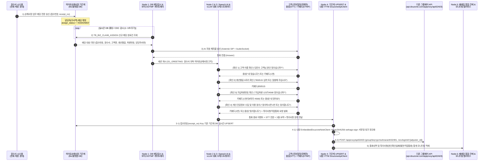
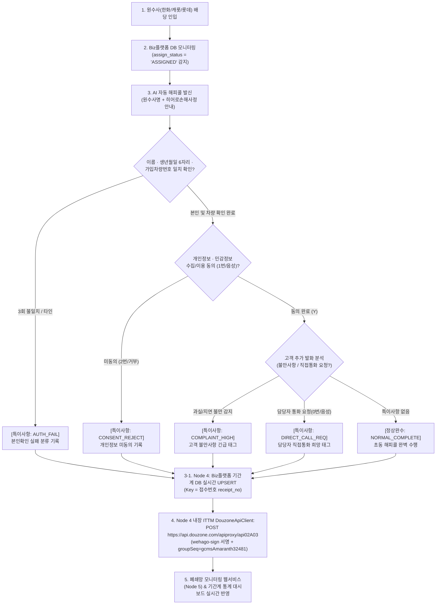
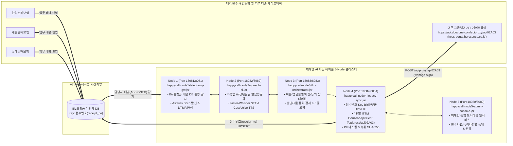

# 히어로손해사정 AI 자동 해피콜(초동 안내·본인확인·개인정보동의) 상세 구축계획서 및 설계도

> [!IMPORTANT]
> **히어로손해사정 핵심 업무 프로세스(5-Step E2E) 및 ITTM 더존 쪽지 API 무노드(Node 4 내장) 통합 반영**
> 1. **원수사 업무 배당 인입**: 수탁 원수사(**한화손해보험, 캐롯손해보험, 롯데손해보험**)로부터 당사(**히어로손해사정**) 기간계 시스템(**Biz플랫폼**)에 사고조사/손해사정 건이 배당됩니다.
> 2. **Biz플랫폼 DB 실시간 모니터링 및 트리거**: Biz플랫폼 배당 테이블(`TB_BIZ_CLAIM_ASSIGN`)을 실시간 감시(Polling/CDC)하다가 신규 데이터가 인입되고 **담당자 배당 완료(`ASSIGNED`)** 상태가 되면 AI 해피콜 발신 큐로 즉시 트리거합니다.
> 3. **AI 자동 해피콜 발신 및 기간계 실시간 UPSERT (Key: `접수번호`)**: AI 음성봇이 고객에게 발신하여 **① 이름, ② 생년월일(6자리), ③ 가입차량번호**, 그리고 **④ 개인(신용)·민감정보 수집·이용 동의**를 음성(STT) 또는 키패드(DTMF)로 취득하고, 통화 종료 즉시 **`접수번호(receipt_no)`를 Key 값으로 Biz플랫폼 기간계 DB에 실시간 UPSERT**합니다.
> 4. **배당 담당자 더존(Douzone) 그룹웨어 쪽지 실시간 발송 (별도 노드 없이 `Node 4` 내부에 ITTM `DouzoneApiClient` 통합)**: 사내 `ITTM(ITSM)` 프로젝트([`ITSM-prod.jar`](file:///c:/myWork/workspace/scratch/ITTM/dist/ITSM-prod.jar) / [`DouzoneApiClient.java`](file:///c:/myWork/workspace/scratch/ITTM/src/main/java/com/hero/itsm/util/DouzoneApiClient.java))를 REA(`ev_60d4eed27601980a8c180b713c459fc270b45a04722e63f371b60634a1ade6f9`)로 분석하여 별도 노드를 두지 않고 가장 인접한 **`Node 4`([`LegacySyncArchiverServer.java`](file:///c:/myWork/workspace/scratch/AI_Call/src/com/hero/happycall/node4/LegacySyncArchiverServer.java)) 내부에 직접 내장**했습니다. UPSERT 직후 `POST https://api.douzone.com/apiproxy/api02A03` (`HmacSHA256 wehago-sign`, `groupSeq: gcmsAmaranth32481`, `callerName: HERO`, `host: portal.herosonsa.co.kr`)를 호출하여 배당 조사역(`recvloginId`)에게 실시간 쪽지를 발송합니다.
> 5. **특이사항(본인확인 실패·고객불만·직접통화 희망 등) 통계 및 폐쇄망 웹 모니터링**: 모든 통화 내역(CDR, 화자분리 STT, 녹취 해시)과 본인확인 실패, 고객 불만 감지, 담당자 직접통화 요청 등의 이상 징후 통계를 기록하고, **Biz플랫폼 임베디드 화면 또는 폐쇄망 전용 모니터링 웹서비스(`Node 5`)**에서 실시간 조회합니다.

---

## 1. 전체 업무 프로세스 흐름도 (End-to-End Business Process Diagram)

### 1.1 5단계 업무 흐름 및 시스템 간 시퀀스 다이어그램



### 1.2 고객 응답 분기 및 예외/특이사항 처리 플로우차트



---

## 2. 인프라 구축 계획 및 5-Node 망분리 아키텍처 설계도

로컬 개발 환경(Windows)과 폐쇄망 운영 환경(Linux)에서 각 서버의 역할과 보안 경계를 분리하기 위해 **5개의 독립 실행형 JAR 파일**과 **전용 포트(로컬 `18080`~`18084` / 운영 `8080`~`8084`)**로 구분하여 구축하며, 더존 그룹웨어 쪽지 발송 기능은 별도 노드 없이 **`Node 4` 내부에 내장**합니다.



| 노드 구분 | 서버 역할 및 탑재 모듈 | 독립 실행 JAR 파일명 | 로컬 포트 | 운영 포트 | 전용 빌드/기동/중지 스크립트 |
| :---: | :--- | :--- | :---: | :---: | :--- |
| **Node 1** | Biz플랫폼 DB 배당 감시자 + 30ch 다이얼러 + DTMF/음성 게이트웨이 | `happycall-node1-telephony-gw.jar` | `18081` | `8081` | `build_node1.bat` / `bk_and_start_node1.sh` / `stop_node1.sh` |
| **Node 2** | 가입차량번호·생년월일 한국어 발음 정규화 + STT/TTS 엔진 | `happycall-node2-speech-ai.jar` | `18082` | `8082` | `build_node2.bat` / `bk_and_start_node2.sh` / `stop_node2.sh` |
| **Node 3** | 이름·생년월일·차량번호·동의 5단계 상태머신 + 특이사항/불만 분류 & 요약 | `happycall-node3-llm-orchestrator.jar` | `18083` | `8083` | `build_node3.bat` / `bk_and_start_node3.sh` / `stop_node3.sh` |
| **Node 4** | `접수번호` Key Biz플랫폼 실시간 UPSERT + **ITTM `DouzoneApiClient`(`/apiproxy/api02A03`) 내장** + PII 마스킹 | `happycall-node4-legacy-sync.jar` | `18084` | `8084` | `build_node4.bat` / `bk_and_start_node4.sh` / `stop_node4.sh` |
| **Node 5** | 폐쇄망 통합 모니터링 웹서비스 (통계·특이사항·STT·녹취·더존쪽지 조회) | `happycall-node5-admin-console.jar` | `18080` | `8080` | `build_node5.bat` / `bk_and_start_node5.sh` / `stop_node5.sh` |

---

## 3. 응용프로그램 구축 계획 및 대화 상태머신(FSM) 상세 설계

1. **`S1_GREETING` (발신 및 원수사·히어로손해사정 소속 고지)**
   - 발화 예시: *"안녕하십니까, {고객명} 고객님. {한화손해보험/캐롯손해보험/롯데손해보험}으로부터 자동차 사고조사 업무를 위탁받은 히어로손해사정 AI 안내봇입니다. 원활한 보상 처리를 위해 몇 가지 확인을 진행하겠습니다."*
2. **`S2_NAME_BIRTH_VERIFY` (이름 및 생년월일 6자리 확인)**
   - 발화 예시: *"{고객명} 고객님 본인 맞으시면 생년월일 여섯 자리를 키패드로 입력하시거나 말씀해 주십시오."*
   - 검증 로직: Biz플랫폼 배당 원장의 `birth_ymd`(예: `850515`)와 키패드(DTMF) 또는 음성(STT) 숫자 비교. 3회 불일치 시 `AUTH_FAIL`(본인확인 실패)로 분류 후 통화 종료 및 담당자 긴급 쪽지 발송.
3. **`S3_VEHICLE_VERIFY` (가입차량번호 일치 확인)**
   - 발화 예시: *"확인 감사합니다. 이번 접수 건의 가입차량번호가 {123가 4568} 차량이 맞으시면 키패드 1번을 누르시거나 맞습니다라고 말씀해 주십시오."*
   - 한국어 발음 정규화: `123가4568` -> `"일이가삼 가 사오육팔"`로 자연스럽게 TTS 발화하며, 고객이 차량번호 뒤 4자리(`4568`)를 입력하거나 `"맞아요"`라고 대답하면 `vehicle_verified_yn = 'Y'` 확정.
4. **`S4_PRIVACY_CONSENT` (개인정보 및 민감정보 수집·이용 동의 취득)**
   - 발화 예시: *"손해사정 및 보험금 산정을 위해 개인신용정보 및 민감정보 수집·이용에 동의하시면 키패드 1번을 누르시거나 동의합니다라고 말씀해 주십시오. 배당 담당자와 직접 통화를 원하시면 0번을 눌러주십시오."*
   - 특이사항 실시간 감지: 고객이 과실비율·지연 등에 불만을 표출하면 `COMPLAINT_HIGH`(고객 불만사항), `0`번 또는 `"담당자 통화"`를 요청하면 `DIRECT_CALL_REQ`(직접통화 희망)로 즉시 태깅.
5. **`S5_CLOSING` (담당 조사역 안내 및 종료 후 Node 4 UPSERT + 더존 쪽지 트리거)**
   - 발화 예시: *"동의 및 확인 절차가 완료되었습니다. 배당된 히어로손해사정 {담당자명} 조사역에게 내용을 즉시 전달하였습니다. 감사합니다."*

---

## 4. 기간계(Biz플랫폼) 및 ITTM 더존(Douzone) 그룹웨어 연계 설계도

### 4.1 표준 연계 인터페이스 목록

| 인터페이스 ID | 인터페이스 명칭 | 출발지 -> 목적지 | 연계 방식 / 주기 | 핵심 식별 키 및 처리 내용 |
| :---: | :--- | :--- | :--- | :--- |
| **IF-BIZ-001** | 원수사 배당 완료건 실시간 감지 | Biz플랫폼 DB -> Node 1 | DB Polling / CDC (초단위) | `assign_status = 'ASSIGNED'` 및 `happycall_status = 'WAIT'` 대상 추출 (`receipt_no` 기준) |
| **IF-BIZ-002** | 해피콜 수집 결과 기간계 실시간 UPSERT | Node 4 -> Biz플랫폼 DB | JDBC / REST Transaction | **Key: `receipt_no` (접수번호)** 기준 이름·생년월일·차량번호 확인여부, 개인정보동의(`Y/N`), 특이사항 코드, 3줄 요약, 녹취 해시 즉시 **UPSERT** |
| **IF-DZ-001** | 배당 담당자 더존 쪽지 알림 발송 (Node 4 내장) | Node 4 -> `api.douzone.com` | `POST /apiproxy/api02A03` | ITTM `DouzoneApiClient` 규격 그대로 `HmacSHA256 wehago-sign` 서명, `groupSeq=gcmsAmaranth32481`, `callerName=HERO`, `host=portal.herosonsa.co.kr`, `recvloginId=[adjuster_id]`로 실시간 쪽지 발송 |
| **IF-MON-001** | 통화내역 및 특이사항 통계·모니터링 적재 | Node 4 -> Node 5 (웹콘솔) | 내부 REST / JSON 동기화 | 원수사별(한화/캐롯/롯데) 완수율, 본인확인 실패율, 고객 불만 건수, 직접통화 요청 건수 실시간 집계 |
| **IF-BIZ-003** | 일배치 미발신·미동기화 정합성 대사 | Node 4 <-> Biz플랫폼 DB | 매일 01:00 / 수동 실행 | 당일 배당된 전체 `receipt_no` 대비 해피콜 수행 결과 및 UPSERT 누락 건 전수 대사 및 DLQ 자동 복구 |

### 4.2 Biz플랫폼 `접수번호(receipt_no)` 기준 UPSERT 표준 SQL 명세

```sql
INSERT INTO TB_BIZ_HAPPYCALL_UPSERT (
    receipt_no, insurer_code, insurer_name, cust_name, birth_ymd_masked,
    vehicle_no, adjuster_id, adjuster_name, name_verified_yn, birth_verified_yn,
    vehicle_verified_yn, privacy_consent_yn, consent_input_mode, anomaly_type,
    customer_note, summary_3lines, rec_sha256_hash, douzone_note_sent_yn, upserted_at
) VALUES (
    :receipt_no, :insurer_code, :insurer_name, :cust_name, :birth_ymd_masked,
    :vehicle_no, :adjuster_id, :adjuster_name, :name_verified_yn, :birth_verified_yn,
    :vehicle_verified_yn, :privacy_consent_yn, :consent_input_mode, :anomaly_type,
    :customer_note, :summary_3lines, :rec_sha256_hash, :douzone_note_sent_yn, CURRENT_TIMESTAMP
)
ON CONFLICT (receipt_no) DO UPDATE SET
    name_verified_yn     = EXCLUDED.name_verified_yn,
    birth_verified_yn    = EXCLUDED.birth_verified_yn,
    vehicle_verified_yn  = EXCLUDED.vehicle_verified_yn,
    privacy_consent_yn   = EXCLUDED.privacy_consent_yn,
    consent_input_mode   = EXCLUDED.consent_input_mode,
    anomaly_type         = EXCLUDED.anomaly_type,
    customer_note        = EXCLUDED.customer_note,
    summary_3lines       = EXCLUDED.summary_3lines,
    rec_sha256_hash      = EXCLUDED.rec_sha256_hash,
    douzone_note_sent_yn = EXCLUDED.douzone_note_sent_yn,
    upserted_at          = CURRENT_TIMESTAMP;
```
