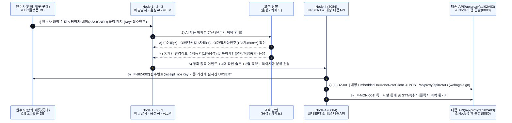
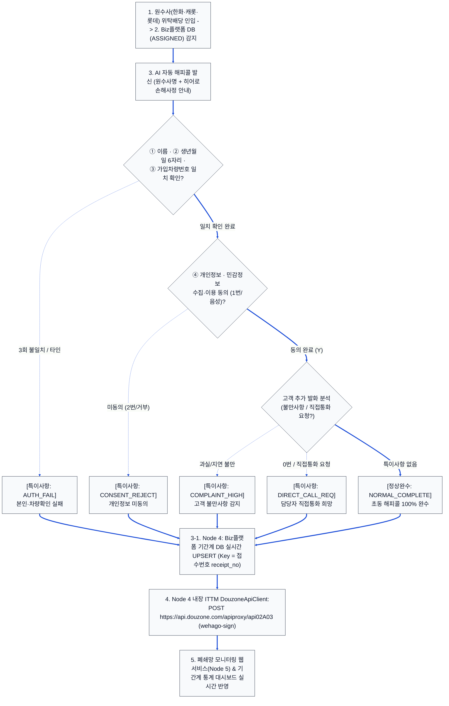
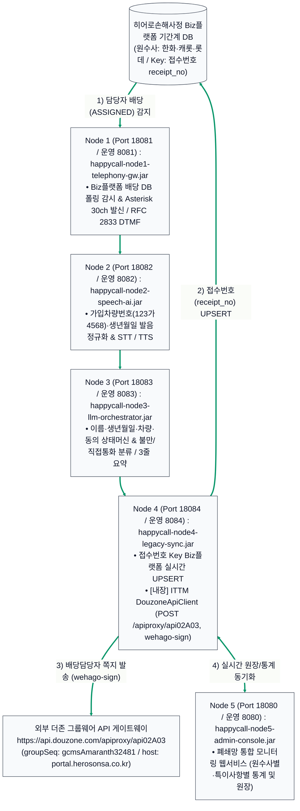

# 히어로손해사정 AI 자동 해피콜(초동 안내·본인확인·개인정보동의) 상세 구축계획서 및 설계도

> [!IMPORTANT]
> **히어로손해사정 핵심 업무 프로세스(5-Step E2E) 및 ITTM 더존 쪽지 API 무노드(Node 4 내장) 통합 반영**
> 1. **원수사 업무 배당 인입**: 수탁 원수사(**한화손해보험, 캐롯손해보험, 롯데손해보험**)로부터 당사(**히어로손해사정**) 기간계 시스템(**Biz플랫폼**)에 사고조사/손해사정 건이 배당됩니다.
> 2. **Biz플랫폼 DB 실시간 모니터링 및 트리거**: Biz플랫폼 배당 테이블(`TB_BIZ_CLAIM_ASSIGN`)을 실시간 감시(Polling/CDC)하다가 신규 데이터가 인입되고 **담당자 배당 완료(`ASSIGNED`)** 상태가 되면 AI 해피콜 발신 큐로 즉시 트리거합니다.
> 3. **AI 자동 해피콜 발신 및 기간계 실시간 UPSERT (Key: `접수번호`)**: AI 음성봇이 고객에게 발신하여 **① 이름, ② 생년월일(6자리), ③ 가입차량번호**, 그리고 **④ 개인(신용)·민감정보 수집·이용 동의**를 음성(STT) 또는 키패드(DTMF)로 취득하고, 통화 종료 즉시 **`접수번호(receipt_no)`를 Key 값으로 Biz플랫폼 기간계 DB에 실시간 UPSERT**합니다.
> 4. **배당 담당자 더존(Douzone) 그룹웨어 쪽지 실시간 발송 (별도 노드 없이 `Node 4` 내부에 ITTM `DouzoneApiClient` 통합)**: 사내 `ITTM(ITSM)` 프로젝트([`ITSM-prod.jar`](file:///c:/myWork/workspace/scratch/ITTM/dist/ITSM-prod.jar) / [`DouzoneApiClient.java`](file:///c:/myWork/workspace/scratch/ITTM/src/main/java/com/hero/itsm/util/DouzoneApiClient.java))를 REA(`ev_60d4eed27601980a8c180b713c459fc270b45a04722e63f371b60634a1ade6f9`)로 분석하여 별도 노드를 두지 않고 가장 인접한 **`Node 4`([`LegacySyncArchiverServer.java`](file:///c:/myWork/workspace/scratch/AI_Call/src/com/hero/happycall/node4/LegacySyncArchiverServer.java)) 내부에 직접 내장**했습니다. UPSERT 직후 `POST https://api.douzone.com/apiproxy/api02A03` (`HmacSHA256 wehago-sign`, `groupSeq: gcmsAmaranth32481`, `callerName: HERO`, `host: portal.herosonsa.co.kr`)를 호출하여 배당 조사역(`recvloginId`)에게 실시간 쪽지를 발송합니다.
> 5. **특이사항(본인확인 실패·고객불만·직접통화 희망 등) 통계 및 폐쇄망 웹 모니터링**: 모든 통화 내역(CDR, 화자분리 STT, 녹취 해시)과 본인확인 실패, 고객 불만 감지, 담당자 직접통화 요청 등의 이상 징후 통계를 기록하고, **Biz플랫폼 임베디드 화면 또는 폐쇄망 전용 모니터링 웹서비스(`Node 5`)**에서 실시간 조회합니다.

---

## 1. 전체 업무 프로세스 흐름도 (대형 폰트 가독성 최적화)

### 1.1 [다이어그램 1-1] 5단계 업무 흐름 및 시스템 간 시퀀스 다이어그램

---

### 1.2 [다이어그램 1-2] 고객 응답 분기 및 예외/특이사항 처리 플로우차트

---

## 2. 인프라 구축 계획 및 5-Node 망분리 아키텍처 설계도

### 2.1 [다이어그램 2-1] 5-Node 클러스터 및 Node 4 내장 더존 API 구조도

---

### 2.2 [도표 1] 5대 독립 실행 노드 및 스크립트 매핑표

| 노드 | 독립 실행 JAR 및 포트 | 핵심 탑재 역할 | 전용 빌드 · 기동 · 중지 스크립트 |
| :---: | :--- | :--- | :--- |
| **Node 1** | `happycall-node1-telephony-gw.jar` Local `18081` / Prod `8081` | Biz플랫폼 DB 배당 감시자 + 30ch 다이얼러 + DTMF/음성 게이트웨이 | `build_node1.bat` `bk_and_start_node1.sh` / `stop_node1.sh` |
| **Node 2** | `happycall-node2-speech-ai.jar` Local `18082` / Prod `8082` | 가입차량번호(`123가4568`)·생년월일 한국어 발음 정규화 + STT/TTS 엔진 | `build_node2.bat` `bk_and_start_node2.sh` / `stop_node2.sh` |
| **Node 3** | `happycall-node3-llm-orchestrator.jar` Local `18083` / Prod `8083` | 이름·생년월일·차량번호·동의 5단계 상태머신 + 특이사항 분류 & 3줄 요약 | `build_node3.bat` `bk_and_start_node3.sh` / `stop_node3.sh` |
| **Node 4** | `happycall-node4-legacy-sync.jar` Local `18084` / Prod `8084` | `접수번호` Key Biz플랫폼 실시간 UPSERT + **내장 ITTM `DouzoneApiClient`(`wehago-sign`)** + PII 마스킹 | `build_node4.bat` `bk_and_start_node4.sh` / `stop_node4.sh` |
| **Node 5** | `happycall-node5-admin-console.jar` Local `18080` / Prod `8080` | 폐쇄망 통합 모니터링 웹서비스 (통계·특이사항·STT·녹취·더존쪽지 조회) | `build_node5.bat` `bk_and_start_node5.sh` / `stop_node5.sh` |

---

## 3. [도표 2] 기간계(Biz플랫폼) 및 ITTM 더존(Douzone) 그룹웨어 연계 인터페이스

| IF ID | 인터페이스 명칭 | 송수신 구간 및 방식 | 핵심 식별 키 및 처리 내용 |
| :---: | :--- | :--- | :--- |
| **IF-BIZ-001** | 원수사 배당 완료건 실시간 감지 | Biz플랫폼 DB ➔ Node 1 (DB Polling / 초단위) | `assign_status = 'ASSIGNED'` 및 `happycall_status = 'WAIT'` 대상 추출 (`receipt_no` 기준) |
| **IF-BIZ-002** | 해피콜 수집 결과 기간계 실시간 UPSERT | Node 4 ➔ Biz플랫폼 DB (JDBC Transaction) | **Key: `receipt_no` (접수번호)** 기준 이름·생년월일·차량번호 확인여부, 개인정보동의(`Y/N`), 특이사항 코드, 3줄 요약, 녹취 해시 즉시 **UPSERT** |
| **IF-DZ-001** | 배당 담당자 더존 쪽지 발송 (Node 4 내장) | Node 4 ➔ `api.douzone.com` (`POST /apiproxy/api02A03`) | ITTM `DouzoneApiClient` 규격 그대로 `HmacSHA256 wehago-sign` 서명, `groupSeq=gcmsAmaranth32481`, `callerName=HERO`, `host=portal.herosonsa.co.kr`, `recvloginId=[adjuster_id]` 실시간 쪽지 발송 |
| **IF-MON-001** | 통화내역 및 특이사항 통계·모니터링 적재 | Node 4 ➔ Node 5 웹콘솔 (REST JSON 동기화) | 원수사별(한화/캐롯/롯데) 완수율, 본인확인 실패율, 고객 불만 건수, 직접통화 요청 건수 실시간 집계 |
| **IF-BIZ-003** | 일배치 미발신·미동기화 정합성 대사 | Node 4 ↔ Biz플랫폼 DB (매일 01:00 / 수동 실행) | 당일 배당된 전체 `receipt_no` 대비 해피콜 수행 결과 및 UPSERT 누락 건 전수 대사 및 DLQ 자동 복구 |
