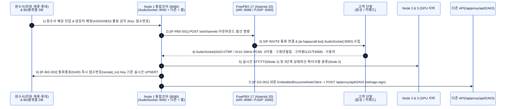
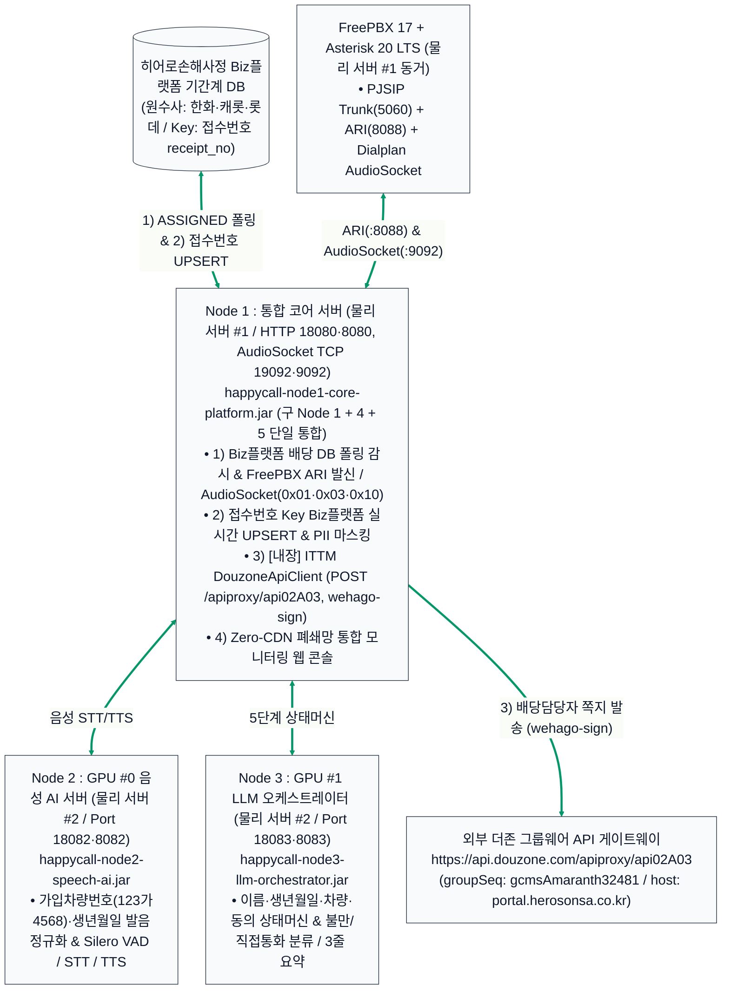

# 히어로손해사정 AI 자동 해피콜(초동 안내·본인확인·개인정보동의) 상세 구축계획서 및 설계도
**(물리 서버 2대 도입 · 3-Node 통합 아키텍처 · FreePBX 17 AudioSocket 연동 · Node 1 내장 더존 API)**

> [!IMPORTANT]
> **물리 서버 2대 도입 확정 및 3-Node 통합(구 Node 1+4+5 ➔ Node 1 단일화) 반영**
> 1. **물리 서버 #1 (일반 CPU 통합 서버 1대 / GPU 불필요)**: **`Node 1: 통합 코어 서버`(`happycall-node1-core-platform.jar`, HTTP `8080`, 내장 AudioSocket TCP `9092`)** + **`FreePBX 17 (Asterisk 20 LTS)`** + **`PostgreSQL 16 / Redis 7.2`** 동시 탑재. 구 `Node 1`(Biz플랫폼 배당DB 폴링 & PBX 게이트웨이) + 구 `Node 4`(Biz플랫폼 `접수번호` UPSERT + ITTM `DouzoneApiClient` 더존 쪽지 내장 + PII 마스킹) + 구 `Node 5`(Zero-CDN 관제 웹 콘솔)를 단 하나의 JAR로 합쳤습니다.
> 2. **물리 서버 #2 (Dual-GPU AI 추론 서버 1대 — NVIDIA L40S 48GB × 2)**:
>    - **`GPU #0`**: **`Node 2 음성 AI 서버`(`happycall-node2-speech-ai.jar`, Port `8082`)** — Silero VAD + Faster-Whisper STT + CosyVoice 2.0 TTS + 한국어 가입차량번호(`123가4568`) 발음 정규화
>    - **`GPU #1`**: **`Node 3 LLM 오케스트레이터 서버`(`happycall-node3-llm-orchestrator.jar`, Port `8083`)** — vLLM (`Qwen2.5-14B/32B-AWQ`) + 5단계 상태머신(`S1`~`S5`) + 특이사항/불만 분류 및 3줄 요약

---

## 1. 전체 업무 프로세스 흐름도 (대형 폰트 가독성 최적화)

### 1.1 [다이어그램 1-1] 5단계 업무 흐름 및 3-Node + FreePBX 시퀀스 다이어그램

---

## 2. 물리 서버 2대 및 3-Node 통합 아키텍처 설계도

### 2.1 [다이어그램 2-1] 물리 서버 2대 · 3-Node 클러스터 및 FreePBX / 더존 API 구조도

---

### 2.2 [도표 1] 물리 서버 2대 · 3대 독립 실행 노드 및 스크립트 매핑표

| 물리 서버 | 노드 | 독립 실행 JAR 및 포트 | 핵심 탑재 역할 | 전용 빌드 · 기동 · 중지 스크립트 |
| :--- | :---: | :--- | :--- | :--- |
| **물리 서버 #1** *(일반 CPU 통합 서버 1대)* | **Node 1** *(구 1+4+5 통합)* | `happycall-node1-core-platform.jar` • HTTP: Local `18080` / Prod `8080` • **AudioSocket: Local `19092` / Prod `9092`** | Biz플랫폼 DB 배당 감시 + FreePBX 17 ARI/AudioSocket 서버 + `접수번호` Key Biz플랫폼 실시간 UPSERT + **내장 ITTM `DouzoneApiClient`(`wehago-sign`)** + Zero-CDN 관제 웹 콘솔 | `build_node1.bat` `bk_and_start_node1.sh` / `stop_node1.sh` `freepbx-setup/install_freepbx17_linux.sh` |
| **물리 서버 #2** *(Dual-GPU 서버 1대 - GPU #0)* | **Node 2** | `happycall-node2-speech-ai.jar` • HTTP: Local `18082` / Prod `8082` | 가입차량번호(`123가4568`)·생년월일 한국어 발음 정규화 + Silero VAD + Faster-Whisper STT + CosyVoice 2.0 TTS | `build_node2.bat` `bk_and_start_node2.sh` / `stop_node2.sh` |
| **물리 서버 #2** *(Dual-GPU 서버 1대 - GPU #1)* | **Node 3** | `happycall-node3-llm-orchestrator.jar` • HTTP: Local `18083` / Prod `8083` | 이름·생년월일·차량번호·동의 5단계 상태머신 + 특이사항 분류 & 3줄 요약 (`vLLM Qwen2.5`) | `build_node3.bat` `bk_and_start_node3.sh` / `stop_node3.sh` |
