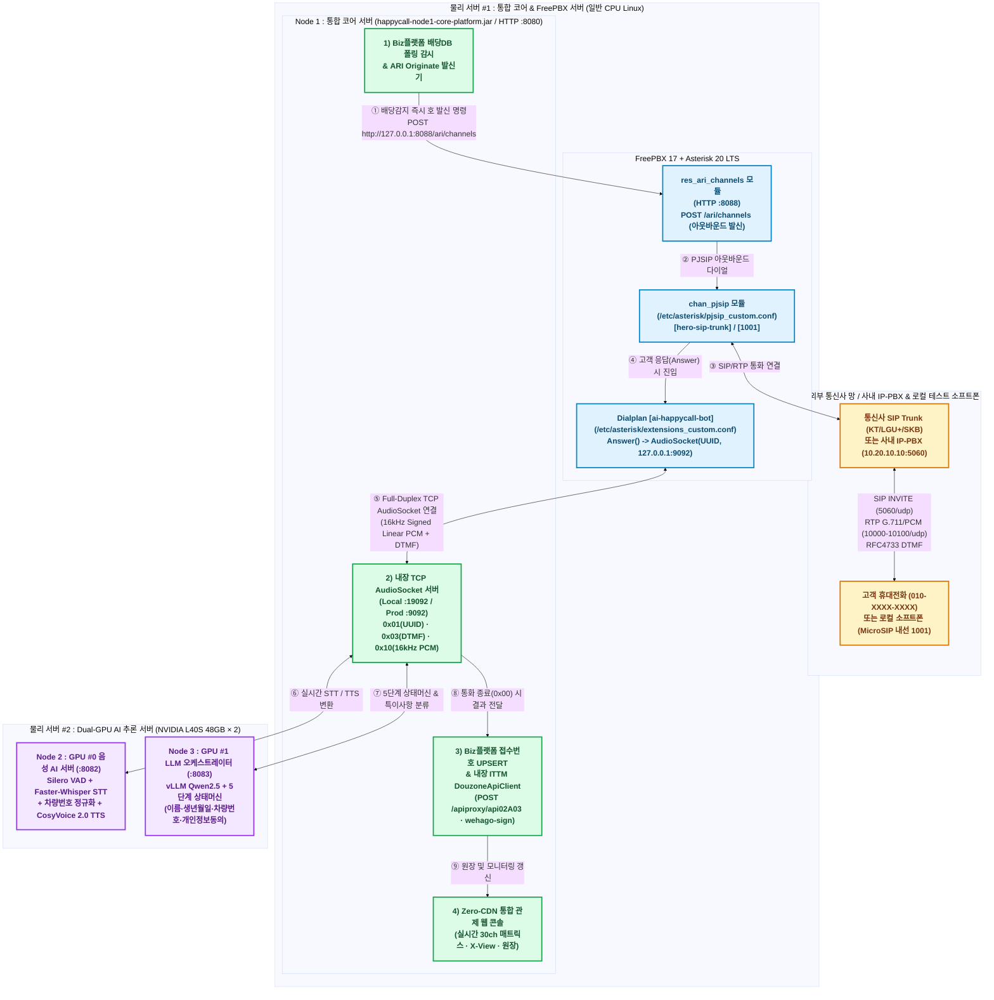

# 09. FreePBX 17 (Asterisk 20 LTS) AI 음성봇 구축 및 연동 상세 기술 가이드

<style>
table { font-size: 16.5px !important; line-height: 1.65 !important; width: 100% !important; border-collapse: collapse; }
th { font-size: 17px !important; font-weight: 700 !important; background-color: #f1f5f9; padding: 12px 14px !important; }
td { padding: 11px 14px !important; }
.mermaid svg { max-width: 100% !important; height: auto !important; min-height: 560px; }
</style>

> **문서 버전**: `2026.10.15-HERO-FREEPBX-PROD`
> **적용 시스템**: 히어로손해사정 AI 자동 해피콜 시스템 (`Node 1 통합 코어 서버` ↔ `FreePBX 17 / Asterisk 20 LTS`)
> **배포 패키지 위치**: [`freepbx-setup/`](file:///c:/myWork/workspace/scratch/AI_Call/freepbx-setup) 및 [`dist/freepbx-setup/`](file:///c:/myWork/workspace/scratch/AI_Call/dist/freepbx-setup)

---

## 1. 물리 서버 도입 대수 확정 및 3-Node 통합 아키텍처 개요

### 1.1 실제 도입해야 할 물리 서버 대수: **총 2대 (또는 GPU 분리 시 3대)**

기존 5개 논리 노드 중 CPU/I/O 중심 워크로드인 **구 `Node 1`(Biz플랫폼 배당DB 폴링 & PBX 게이트웨이)**, **구 `Node 4`(Biz플랫폼 `접수번호` UPSERT + ITTM `DouzoneApiClient` 더존 쪽지 내장 + PII 마스킹)**, **구 `Node 5`(Zero-CDN 통합 관제 웹 콘솔)**를 **단 하나의 통합 서비스인 `Node 1: 통합 코어 서버` (`happycall-node1-core-platform.jar`)**로 합쳤습니다.

이에 따라 소프트웨어 데몬은 **총 3개(`Node 1`, `Node 2`, `Node 3`)**, 실제 구매·도입해야 하는 물리 서버는 **총 2대**로 최적화됩니다.

| 물리 서버 구분 | 하드웨어 도입 규격 (권장) | 탑재 소프트웨어 노드 및 인프라 데몬 | 전용 포트 (Local / Prod) | 비고 |
| :--- | :--- | :--- | :--- | :--- |
| **물리 서버 #1**<br/>**(통합 코어 · FreePBX · DB 서버)**<br/>*[일반 CPU 서버 1대]* | • CPU: 16~32 Core (Xeon/EPYC)<br/>• RAM: 64GB ECC<br/>• Disk: NVMe 2TB RAID-1<br/>• **GPU: 불필요** | 1) **`Node 1 통합 코어 서버`** (`happycall-node1-core-platform.jar`)<br/>  - 구 Node 1(배당폴링/PBX) + 구 Node 4(UPSERT/더존쪽지) + 구 Node 5(웹콘솔) 통합<br/>2) **`FreePBX 17 (Asterisk 20 LTS)`** (IP-PBX / SIP 트렁크 / ARI / AudioSocket)<br/>3) **`PostgreSQL 16`** + **`Redis 7.2`** | • Node 1 HTTP: `18080` / `8080`<br/>• **Node 1 AudioSocket TCP: `19092` / `9092`**<br/>• FreePBX ARI: `8088`<br/>• FreePBX SIP: `5060/udp`<br/>• FreePBX RTP: `10000-10100/udp` | CPU/네트워크 I/O 중심이므로 1대의 서버에 통합 운영 시 루프백(`127.0.0.1`) 통신으로 지연 극소화 |
| **물리 서버 #2**<br/>**(AI 음성 · LLM GPU 서버)**<br/>*[Dual-GPU 서버 1대]* | • CPU: 32 Core<br/>• RAM: 128GB ECC<br/>• **GPU: NVIDIA L40S 48GB × 2장**<br/>(또는 단일 GPU 서버 2대로 분리 가능) | 1) **[GPU #0] `Node 2 음성 AI 서버`** (`happycall-node2-speech-ai.jar`)<br/>  - Silero VAD v5 + Faster-Whisper STT + CosyVoice 2.0 TTS + 차량번호 발음정규화<br/>2) **[GPU #1] `Node 3 LLM 오케스트레이터`** (`happycall-node3-llm-orchestrator.jar`)<br/>  - vLLM (`Qwen2.5-14B/32B-AWQ`) + 5단계 상태머신 + 특이사항/불만 분류 | • Node 2 HTTP: `18082` / `8082`<br/>• Node 3 HTTP: `18083` / `8083` | GPU VRAM 간섭 방지를 위해 `CUDA_VISIBLE_DEVICES=0` (Node 2), `CUDA_VISIBLE_DEVICES=1` (Node 3) 격리 |

---

## 2. FreePBX 17 (Asterisk 20 LTS) 기반 AI 음성봇 전화 발신 및 양방향 스트리밍 구조도

AI 음성봇이 실제 고객 휴대전화로 아웃바운드 해피콜을 발신하고 실시간으로 대화하려면, **① 호 제어(Call Originate: ARI `:8088`)**, **② 외부 전화망 연동(PJSIP SIP Trunk `:5060` + RTP `:10000~10100`)**, **③ AI 서버와의 실시간 양방향 음성/DTMF 파이프(`AudioSocket` TCP `:9092` / 로컬 `:19092`)** 3가지가 맞물려야 합니다.



---

## 3. FreePBX (Asterisk 20) ↔ Node 1 AudioSocket 바이너리 프로토콜 명세

Asterisk 18/20+에 기본 내장된 `app_audiosocket` / `res_audiosocket` 모듈은 외부 SIP 스택 오버헤드 없이 순수 TCP 소켓 위에서 초저지연(10~20ms 패킷)으로 양방향 음성과 DTMF를 주고받습니다. [`CorePlatformServer.java`](file:///c:/myWork/workspace/scratch/AI_Call/src/com/hero/happycall/node1/CorePlatformServer.java) 내부에 이 프로토콜 처리기가 100% 네이티브 구현되어 있습니다.

| 프레임 타입 (1 Byte) | 길이 헤더 (2 Bytes, Big-Endian) | 페이로드 (Payload) | 방향 | 처리 내용 (`CorePlatformServer.java`) |
| :--- | :--- | :--- | :--- | :--- |
| **`0x01` (UUID)** | `0x00 0x10` (16 Bytes) | 통화 채널의 128-bit Binary UUID | FreePBX → Node 1 | 통화 연결 직후 1회 전송. `CLAIM_NO`(`접수번호`) 세션과 매핑하여 상태머신(`S1_GREETING`) 초기화 및 첫 인사말 TTS 전송 |
| **`0x03` (DTMF)** | `0x00 0x01` (1 Byte) | 눌린 키패드 ASCII 문자 (`'0'`~`'9'`, `'*'`, `'#'`) | FreePBX → Node 1 | 고객이 누른 생년월일 6자리(`850515`) 또는 개인정보 수집 동의(`1`번)를 즉시 캡처하여 오인식률 0%로 인증 처리 |
| **`0x10` (Audio PCM)** | `0x01 0x40` (320 Bytes = 10ms) 또는 `0x02 0x80` (640 Bytes = 20ms) | **16kHz, 16-bit, Mono, Signed Linear PCM (`slin16`)** | **양방향 (Full-Duplex)** | • **FreePBX → Node 1**: 고객 발화 음성을 `Node 2` Silero VAD / Faster-Whisper STT로 스트리밍 (Barge-in 시 즉시 TTS 중단)<br/>• **Node 1 → FreePBX**: `Node 2` CosyVoice 2.0이 합성한 AI 봇 음성을 320B/640B 프레임으로 쪼개어 실시간 재생 |
| **`0x00` (Hangup)** | `0x00 0x00` (0 Byte) | 없음 (연결 종료) | 양방향 | 통화 종료 즉시 `Node 1`이 **① PII 생년월일 구간 녹취 묵음 마스킹(SHA-256)**, **② Biz플랫폼 `접수번호` UPSERT**, **③ 더존 쪽지 API(`/apiproxy/api02A03`) 발송**을 자동 수행 |

---

## 4. `freepbx-setup/` 패키지 구성 파일 및 상세 설정 방법

모든 설정 파일과 스크립트는 프로젝트 루트의 [`freepbx-setup/`](file:///c:/myWork/workspace/scratch/AI_Call/freepbx-setup) (빌드 시 [`dist/freepbx-setup/`](file:///c:/myWork/workspace/scratch/AI_Call/dist/freepbx-setup) 및 [`dist/node1-core-platform/freepbx-setup/`](file:///c:/myWork/workspace/scratch/AI_Call/dist/node1-core-platform/freepbx-setup)에 자동 포함)에 완비되어 있습니다.

| 파일 경로 | 용도 및 핵심 설정 내용 |
| :--- | :--- |
| [`freepbx-setup/docker-compose.freepbx.yml`](file:///c:/myWork/workspace/scratch/AI_Call/freepbx-setup/docker-compose.freepbx.yml) | 로컬 Windows (Docker Desktop) 및 리눅스 컨테이너 환경에서 FreePBX 17 + Asterisk 20을 원클릭 기동하는 Compose 파일 (`8089:80` Web GUI, `8088` ARI, `5060/udp` PJSIP, `10000-10100/udp` RTP) |
| [`freepbx-setup/install_freepbx17_linux.sh`](file:///c:/myWork/workspace/scratch/AI_Call/freepbx-setup/install_freepbx17_linux.sh) | 운영 리눅스 서버(물리 서버 #1)의 `/etc/asterisk/`에 커스텀 설정 5종을 백업 후 배포하고, 방화벽 포트 오픈 및 `fwconsole reload` / `asterisk -rx "core reload"`를 자동 수행하는 스크립트 |
| [`freepbx-setup/asterisk-etc/pjsip_custom.conf`](file:///c:/myWork/workspace/scratch/AI_Call/freepbx-setup/asterisk-etc/pjsip_custom.conf) | ① 운영 통신사/사내 IP-PBX 연동용 **`[hero-sip-trunk]`** (`ulaw`/`alaw`/`slin16`, `dtmf_mode=rfc4733`)<br/>② 로컬 소프트폰(MicroSIP/Zoiper) 테스트용 내선 **`[1001]`** (비밀번호: `hero1001!`) |
| [`freepbx-setup/asterisk-etc/extensions_custom.conf`](file:///c:/myWork/workspace/scratch/AI_Call/freepbx-setup/asterisk-etc/extensions_custom.conf) | ① **`[ai-happycall-bot]`**: ARI Originate로 고객 전화가 연결되면 `Answer()` 후 `AudioSocket(${CALL_UUID}, 127.0.0.1:9092)`로 Node 1과 양방향 오디오 파이프 수립<br/>② **`[from-internal-custom] exten 9999`**: 로컬 소프트폰(`1001`)에서 `9999`번 발신 시 즉시 로컬 Node 1(`127.0.0.1:19092`) AI 봇과 대화 테스트 |
| [`freepbx-setup/asterisk-etc/ari_additional_custom.conf`](file:///c:/myWork/workspace/scratch/AI_Call/freepbx-setup/asterisk-etc/ari_additional_custom.conf) | Node 1이 아웃바운드 콜을 발신(`POST /ari/channels`)할 때 사용하는 ARI 계정 (`happycall_ai` / `happycall_secret`) |
| [`freepbx-setup/asterisk-etc/http_custom.conf`](file:///c:/myWork/workspace/scratch/AI_Call/freepbx-setup/asterisk-etc/http_custom.conf) | Asterisk 내장 HTTP 서버 활성화 (`0.0.0.0:8088`) |
| [`freepbx-setup/asterisk-etc/manager_custom.conf`](file:///c:/myWork/workspace/scratch/AI_Call/freepbx-setup/asterisk-etc/manager_custom.conf) | Asterisk AMI (`5038` 포트) 이벤트 감시 계정 (`happycall_ami`) |
| [`freepbx-setup/test_local_audiosocket_call.ps1`](file:///c:/myWork/workspace/scratch/AI_Call/freepbx-setup/test_local_audiosocket_call.ps1) | 별도 SIP 장비나 Docker 없이도 로컬 Windows에서 PowerShell만으로 Node 1의 `AudioSocket(19092)` 바이너리 프로토콜(`0x01`→`0x03`→`0x10`→`0x00`)과 `POST /api/freepbx/originate`를 즉시 검증하는 스크립트 |

---

## 5. 로컬(Windows) 테스트 및 운영 서버(Linux) 실전 적용 절차

### 5.1 [로컬 테스트 방법 A] 무설치 PowerShell 스크립트 및 웹 콘솔 원클릭 실증 (즉시 가능)

1. 로컬 빌드 및 3-Node 서비스 기동:
   ```bat
   .\build_all.bat
   ```
   - `Node 1`이 HTTP `18080` 포트와 **Asterisk AudioSocket TCP `19092` 포트**를 동시에 오픈합니다.
2. 웹 브라우저(`http://localhost:18080`) 접속 후 상단 대시보드의 **"FreePBX 아웃바운드 해피콜 발신 + AudioSocket 실증 실행"** 버튼을 클릭하거나, 아래 PowerShell 스크립트를 실행합니다:
   ```powershell
   powershell -ExecutionPolicy Bypass -File .\freepbx-setup\test_local_audiosocket_call.ps1
   ```
3. 실행 즉시 `0x01(UUID)` → `0x03(DTMF '1')` → `0x10(16kHz PCM)` → `Node 1 TTS 0x10 응답` → `0x00(Hangup)` → `Biz플랫폼 접수번호 UPSERT` → `더존 쪽지 API(/apiproxy/api02A03)` 전체 파이프라인이 실증됩니다.

### 5.2 [로컬 테스트 방법 B] Docker FreePBX 17 + MicroSIP 소프트폰으로 실제 음성 통화 테스트

1. 로컬 PC에서 FreePBX 17 컨테이너 기동:
   ```bash
   docker compose -f freepbx-setup/docker-compose.freepbx.yml up -d
   ```
2. 무료 Windows 소프트폰(**MicroSIP** 또는 **Zoiper**) 실행 후 내선 등록:
   - **SIP Server**: `127.0.0.1:5060`
   - **Username / Extension**: `1001`
   - **Password**: `hero1001!`
3. 소프트폰에서 **`9999`** 번으로 통화 버튼을 누르면 `[from-internal-custom]` 다이얼플랜을 통해 로컬 `Node 1`(`host.docker.internal:19092`)로 AudioSocket이 연결되며, 헤드셋으로 AI 해피콜 음성봇과 실제 통화 및 키패드(DTMF) 입력을 테스트할 수 있습니다.

### 5.3 [운영 서버 배포] 폐쇄망 리눅스 물리 서버 #1 적용 절차

1. 운영 물리 서버 #1에 배포 패키지(`dist/node1-core-platform/`) 복사 후 FreePBX 설정 자동 적용:
   ```bash
   cd /opt/happycall/node1-core-platform/freepbx-setup
   chmod +x install_freepbx17_linux.sh
   sudo ./install_freepbx17_linux.sh 127.0.0.1:9092
   ```
2. 사내 IP-PBX 또는 통신사(KT/LGU+/SKB) SIP Trunk IP 주소를 `/etc/asterisk/pjsip_custom.conf`의 `[hero-sip-trunk]` 섹션(`10.20.10.10`)에 맞게 수정한 뒤 리로드:
   ```bash
   sudo asterisk -rx "core reload"
   sudo asterisk -rx "pjsip show endpoints"
   ```
3. `Node 1` 통합 코어 서버 기동 (HTTP `8080`, AudioSocket `9092`):
   ```bash
   cd /opt/happycall/node1-core-platform
   chmod +x bk_and_start_node1.sh stop_node1.sh
   ./bk_and_start_node1.sh
   ```
